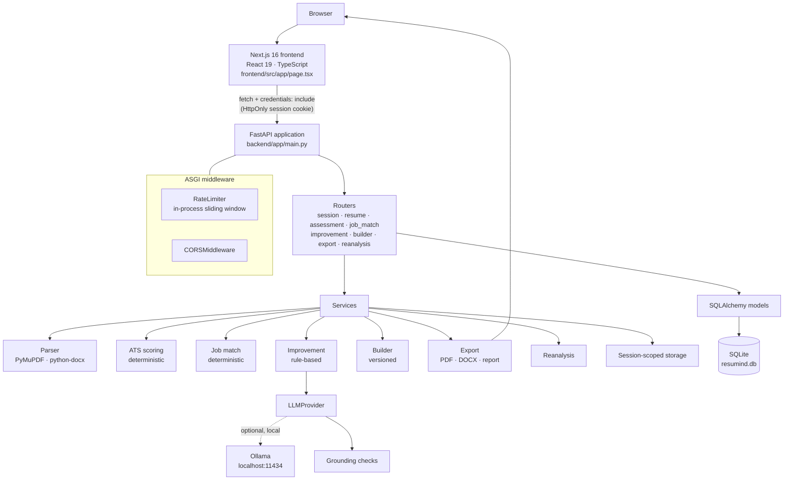
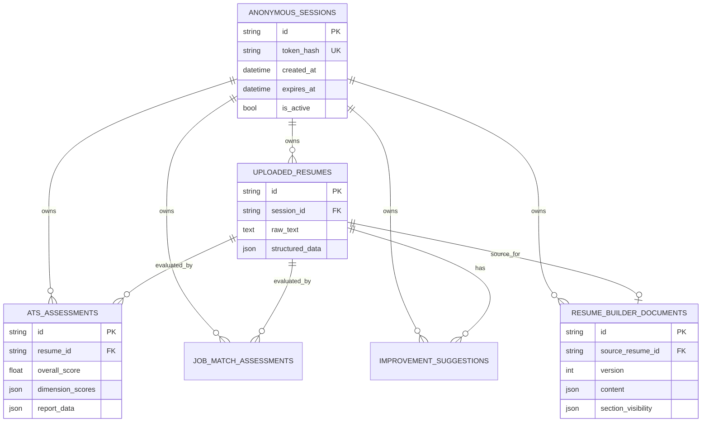

<div align="center">

# RESUMIND AI

### Career Signal Studio

**Analyze. Understand. Improve. Build.**

An intelligent resume analysis and optimization platform that helps candidates understand ATS readiness, evaluate alignment with a job description, improve resume content with full editorial control, and generate professional documents.

[](https://www.python.org/)
[](https://fastapi.tiangolo.com/)
[](https://nextjs.org/)
[](https://react.dev/)
[](https://www.typescriptlang.org/)
[](https://www.sqlalchemy.org/)
[](https://www.sqlite.org/)
[](https://pymupdf.readthedocs.io/)
[](backend/tests)
[](#limitations)

[Overview](#overview) · [Features](#feature-highlights) · [Architecture](#architecture) · [Setup](#local-installation) · [API](#api-surface) · [Docs](#documentation) · [Limitations](#limitations)

</div>

---

> **Project status.** RESUMIND AI is a **local application**. It has not been deployed to a public host, and no independent security assessment has been performed. ATS Readiness and Job Match are **heuristic indicators**, not predictions of any employer's ATS behaviour, ranking, or interview outcome.

## Table of Contents

- [Overview](#overview)
- [Screenshots](#screenshots)
- [Feature Highlights](#feature-highlights)
- [Technology Stack](#technology-stack)
- [Architecture](#architecture)
- [User Workflow](#user-workflow)
- [Repository Structure](#repository-structure)
- [API Surface](#api-surface)
- [Local Installation](#local-installation)
- [Configuration](#configuration)
- [Security and Privacy](#security-and-privacy)
- [Testing and Verification](#testing-and-verification)
- [Technical Decisions and Trade-offs](#technical-decisions-and-trade-offs)
- [Limitations](#limitations)
- [Roadmap](#roadmap)
- [Documentation](#documentation)
- [Contributing](#contributing)
- [License](#license)
- [Author](#author)

---

## Overview

### The problem

Resume tools commonly blur two very different questions: *"Will a machine parse this file cleanly?"* and *"Does this candidate match this specific role?"* Mixing them produces misleading single scores, hides the evidence behind the number, and encourages candidates to fabricate metrics the model cannot verify.

### The approach

RESUMIND AI keeps those questions deliberately separate and makes the underlying logic inspectable.

| Concern | Question answered | Implementation |
| :--- | :--- | :--- |
| **Resume parsing** | What does this document actually contain? | PyMuPDF / `python-docx` extraction plus conservative structural parsing |
| **ATS Readiness** | Is this document machine-readable and well structured? | Deterministic five-dimension heuristic — no job description required |
| **Job Match** | Does the resume state evidence for *this* posting? | Deterministic taxonomy matching with verbatim resume citations |
| **Improvement Studio** | How could a bullet be stronger without inventing facts? | Rule-based suggestions and optional local LLM proposals, each requiring explicit acceptance |
| **Resume Builder** | What will the final document say? | Structured editing with versioned persistence |
| **Export** | How is it delivered? | Single-column selectable-text PDF, editable DOCX, diagnostic report PDF |
| **Differential comparison** | What actually changed, and did it matter? | Baseline assessment versus a saved Builder revision, recomputed from the generated PDF |

Nothing in the scoring path guesses. A requirement with no textual evidence is reported as **not demonstrated in the resume** — never as proof the candidate lacks the skill.

### Built for

Job seekers who want to understand how their resume is read before applying; career transitioners mapping existing experience to unfamiliar postings; students and early-career candidates who need project work weighted fairly alongside traditional employment.

---

## Screenshots

> **Not yet available.** No application screenshots exist in this repository, so none are shown above — publishing mockups as product screenshots would misrepresent the UI.
>
> To add authentic captures, run the app locally and save privacy-safe images (synthetic resume data only, no real emails, phone numbers, or session values) to `docs/assets/readme/`, then reference them here:
>
> ```markdown
> | Screen | Image |
> | :--- | :--- |
> | Landing and upload |  |
> | Extraction review |  |
> | ATS Readiness report |  |
> | Job Match report |  |
> | Improvement Studio |  |
> | Resume Builder |  |
> | Export Center |  |
> ```

---

## Feature Highlights

### Resume Intelligence

- **PDF and DOCX ingestion** with extension checks, file-signature validation, a 10 MB ceiling, bounded PDF page counts, and bounded DOCX archive expansion.
- **Structural extraction** into contact details, summary, experience, education, projects, certifications, and categorised skills, with common heading variants and inline headings recognised.
- **Encoding repair** for characters that PDF extractors routinely mis-decode.
- **Editable review** so the user corrects the parsed profile before any assessment runs. Corrections are the ground truth for everything downstream.

### ATS Readiness

- **Five weighted dimensions:** file and text integrity (25 %), structural taxonomy (20 %), contact information (15 %), bullet impact (25 %), length and hygiene (15 %).
- **Deterministic** — identical input yields an identical score. No randomness, no model, no network call.
- **Explainable output** — every dimension returns its sub-score, its weight, and the specific findings and strengths behind it.
- **Runs without a job description**, so a candidate can assess a resume before targeting a role.

### Job Description Matching

- **Requirement extraction** from pasted posting text, categorised into hard technical skills, domain competencies, experience scope, and education/credentials.
- **Required versus preferred** distinguished from posting context.
- **Three evidence states:** matched, partially supported, and not demonstrated.
- **Grounded citations** — returned evidence is verified to be a verbatim substring of the resume; there are no generated quotes.
- **Pro-rata normalisation** when a posting omits an entire category, so a missing requirement type does not silently lower the score.
- **Score withholding** when the posting does not yield enough identifiable requirements.

### Improvement Studio

- **Rule-based suggestions** for passive starters, weak first verbs, missing quantifiable metrics, readability, and repetitive verbs — always available, with no AI required.
- **Optional local AI rewrites** through an abstract `LLMProvider` backed by a local Ollama server.
- **Explicit user control** — every proposal is accepted, rejected, edited, or restored by the candidate. Nothing is applied automatically.
- **Grounding safeguards** — the response contract forbids invented metrics and the validator flags any number or date not present in the original bullet, marking the proposal as needing verification.
- **Stale-content protection** — applying a suggestion against a bullet that has since changed returns a conflict rather than overwriting.
- **Batch acceptance** with placeholder-aware skipping.

### Resume Builder

- **Structured editing** of contact information, summary, experience, projects, skills, education, certifications, and additional sections.
- **One canonical template** — a single-column ATS Professional layout, with legacy template IDs normalised rather than silently varied.
- **Section visibility and ordering**, plus live preview.
- **Versioned persistence** using optimistic concurrency: a stale save from another tab returns `409 Conflict` instead of overwriting newer content.

### Document Generation

- **PDF export** with a real text layer: A4 geometry, standard base fonts, manual line wrapping, pagination, bullet glyphs, and clickable links.
- **DOCX export** using native paragraphs, heading styles, and genuine bullet lists — no floating shapes or text boxes.
- **Diagnostic report PDF** covering the assessment breakdown, requirement matrix, and an actionable checklist.
- **Exports are generated from saved structured data**, not from a screenshot or a re-parse, so the document matches exactly what was reviewed.

### Differential Comparison

- **Implemented** — comparing the original baseline assessment with a saved Builder revision.
- **Genuine measurements** — the revised score is recomputed from the *generated PDF's extracted text*, so only real content changes move the number.
- **Locked states** when preconditions are unmet: no baseline, a baseline older than the last resume update, an assessment built on a different scoring framework, no saved Builder document, or no actual content change (template-only edits do not count).
- **Per-dimension deltas**, changed sections, and resolved findings.

---

## Technology Stack

| Layer | Technologies | Role |
| :--- | :--- | :--- |
| **Frontend** | Next.js 16 (App Router), React 19, TypeScript, Tailwind CSS 4 | Client-side application shell and the seven product screens |
| **Backend** | Python 3.11+, FastAPI, Pydantic v2, `pydantic-settings` | Async JSON API, request validation, typed configuration |
| **Persistence** | SQLAlchemy 2.0 (async), Alembic, SQLite via `aiosqlite` | ORM models, versioned migrations, local database |
| **Production database** | PostgreSQL via `asyncpg` | Documented production target; the driver is a declared dependency, not an exercised deployment |
| **Document processing** | PyMuPDF (`pymupdf`), `python-docx` | PDF/DOCX text extraction *and* generation |
| **AI integration** | Ollama over HTTP, `LLMProvider` abstraction, `httpx` | Optional local rewrite proposals with structured-output validation |
| **Testing** | pytest, pytest-asyncio, httpx; ESLint, TypeScript, Next.js build; Playwright launch gate | Backend suites, build gates, and reproducible browser workflows |

> PDF generation uses **PyMuPDF**, not ReportLab. Motion/shadcn/ui/Radix appear in earlier planning documents but are **not** current dependencies — `frontend/package.json` lists only `next`, `react`, and `react-dom` as runtime dependencies.

---

## Architecture



**Data flow.** Every request carries the HttpOnly session cookie. Middleware applies rate limits and baseline headers, the router resolves the session (a `401` if it is missing or expired), and every subsequent query is scoped to that session ID. Services do the work and Pydantic serialises the response. Only the Improvement Studio's rewrite endpoint touches Ollama, and it is the sole outbound network dependency in the application.

The backend layers are strictly directional: **routers orchestrate → services compute → models persist → schemas validate.** No service imports a router; no model imports a service.

### Database model



Six tables, all keyed by UUID and all cascading from the session, plus indexes on `token_hash` and `expires_at`.

---

## User Workflow

```text
1. Session        POST /api/session            → random token, only its SHA-256 hash stored
2. Upload         POST /api/resume/upload      → validate, parse, persist
3. Review         PUT  /api/resume             → user corrections become the baseline
4. ATS Readiness  POST /api/assessment         → five dimensions, weighted score
   ├─ optional job posting
5. Job Match      POST /api/job-match          → grounded citations and gaps
6. Improvements   POST /api/improvement/generate → rule-based suggestions
7. Rewrite        POST /api/improvement/{id}/rewrite → optional local AI proposal
8. Decide         PUT  /api/improvement/{id}   → accept · edit · reject · restore
9. Builder        PUT  /api/builder            → versioned save
10. Export        GET  /api/export/resume/{pdf|docx}
11. Report        GET  /api/export/report/pdf
12. Comparison    GET  /api/reanalysis         → baseline versus saved revision
```

ATS Readiness never requires a job description — the Job Match branch is entirely optional. On reload, the frontend calls `GET /api/resume` and `GET /api/export/status` to restore the user's position in the workflow.

---

## Repository Structure

```text
RESUMIND-AI/
├── backend/
│   ├── app/
│   │   ├── main.py            # app factory, middleware order, router mounting, lifespan
│   │   ├── config.py          # pydantic-settings, production validation
│   │   ├── database.py        # async engine, session factory, get_db dependency
│   │   ├── models/            # SQLAlchemy ORM models (six tables)
│   │   ├── schemas/           # Pydantic request/response contracts
│   │   ├── routers/           # one module per API area
│   │   ├── services/          # parsing, scoring, job match, builder, export, reanalysis
│   │   ├── providers/         # LLMProvider ABC, Ollama provider, prompts, grounding
│   │   └── middleware/        # rate limiting and security headers
│   ├── alembic/               # migration environment and revision chain
│   ├── tests/                 # pytest suite and synthetic fixture generator
│   ├── requirements.txt
│   └── pytest.ini
├── frontend/
│   ├── src/
│   │   ├── app/               # layout.tsx, page.tsx, globals.css
│   │   ├── components/        # the seven product screens and shared UI
│   │   ├── context/           # SessionContext, ThemeContext
│   │   └── lib/api.ts         # API base URL resolution
│   ├── scripts/               # launch-gate-e2e.mjs (Playwright)
│   ├── public/
│   └── package.json
├── docs/                      # specifications, audits, guides
├── scripts/                   # Windows PowerShell setup / start / test helpers
└── storage/                   # runtime uploads, exports, reports (git-ignored contents)
```

| Directory | Responsibility |
| :--- | :--- |
| `backend/app/routers` | HTTP surface only — session resolution, validation, delegation, error mapping |
| `backend/app/services` | All computation: parsing, both scoring engines, builder conversion, generation, reanalysis |
| `backend/app/providers` | AI boundary: abstract interface, Ollama implementation, prompt templates, grounding |
| `backend/app/models` | Persistence schema and cascade relationships |
| `backend/tests` | Synthetic-data backend suites |
| `frontend/src/components` | Screen-level React components driven by `page.tsx` state |
| `docs` | Specifications, security and readiness records, and the learning guides |
| `scripts` | Reproducible PowerShell entry points |

---

## API Surface

All routes are namespaced under `/api`. Protected routes read the `resumind_session` cookie and return `401` when it is missing or expired. Interactive documentation is served at `/api/docs`.

| Method | Endpoint | Purpose |
| :--- | :--- | :--- |
| `GET` | `/api/health` | Liveness check |
| `POST` | `/api/session` | Create or reuse an anonymous session |
| `GET` | `/api/session` | Inspect the current session |
| `POST` | `/api/session/reset` | Revoke the session and purge its files |
| `POST` | `/api/resume/upload` | Upload, validate, and parse a resume (`201`) |
| `GET` `PUT` `DELETE` | `/api/resume` | Read, update, or delete the active resume |
| `POST` `GET` | `/api/assessment` | Compute or fetch the ATS Readiness assessment |
| `POST` `GET` | `/api/job-match` | Compute or fetch the Job Match assessment |
| `POST` | `/api/improvement/generate` | Generate rule-based suggestions |
| `GET` | `/api/improvement` | List suggestions with counts |
| `PUT` | `/api/improvement/{suggestion_id}` | Accept, edit, or reject a suggestion |
| `POST` | `/api/improvement/batch-accept` | Batch accept high-confidence suggestions |
| `POST` | `/api/improvement/{id}/restore` | Restore original text |
| `POST` | `/api/improvement/{id}/rewrite` | Request an AI rewrite proposal |
| `GET` | `/api/improvement/provider/status` | Report local provider availability |
| `GET` `PUT` | `/api/builder` | Fetch or save the Builder document |
| `POST` | `/api/builder/reset` | Reset the Builder from the resume or a blank starter |
| `GET` | `/api/export/status` | Report export readiness |
| `GET` | `/api/export/resume/pdf` | Download the resume as PDF |
| `GET` | `/api/export/resume/docx` | Download the resume as DOCX |
| `GET` | `/api/export/report/pdf` | Download the diagnostic report |
| `GET` | `/api/reanalysis` | Compare the baseline with the saved revision |

Common error codes: `400` invalid input · `401` missing or expired session · `404` no active resource · `409` version conflict or stale content · `413` upload too large · `422` parsing or validation failure · `429` rate limited.

---

## Local Installation

### Prerequisites

| Requirement | Notes |
| :--- | :--- |
| **Windows 10/11 + PowerShell** | The provided scripts are PowerShell; the application itself is not Windows-specific |
| **Python 3.11+** | Backend runtime |
| **Node.js 20.9+ with npm** | Required by Next.js 16 |
| **Git** | To clone the repository |
| **Ollama** *(optional)* | Only for live AI rewrite proposals |

### 1. Clone

```powershell
git clone https://github.com/Sankha708/RESUMIND-AI.git
Set-Location RESUMIND-AI
```

### 2. Configure environment templates

```powershell
Set-ExecutionPolicy -Scope Process -ExecutionPolicy Bypass
if (-not (Test-Path backend/.env)) { Copy-Item backend/.env.example backend/.env }
if (-not (Test-Path frontend/.env.local)) { Copy-Item frontend/.env.example frontend/.env.local }
```

Both templates contain safe local defaults. Keep the resulting `.env` and `.env.local` private — they are git-ignored.

### 3. Install dependencies and migrate

```powershell
./scripts/setup-backend.ps1
./scripts/setup-frontend.ps1
```

`setup-backend.ps1` creates `backend/.venv`, installs `requirements.txt`, and runs `alembic upgrade head`. `setup-frontend.ps1` installs with `npm ci` and produces a production build.

<details>
<summary>Manual equivalent</summary>

```powershell
cd backend
python -m venv .venv
.\.venv\Scripts\python.exe -m pip install --upgrade pip
.\.venv\Scripts\python.exe -m pip install -r requirements.txt
.\.venv\Scripts\python.exe -m alembic upgrade head
cd ..\frontend
npm ci
```

</details>

### 4. Run

Terminal 1 — backend:

```powershell
./scripts/start-backend.ps1
```

Terminal 2 — frontend:

```powershell
./scripts/start-frontend.ps1
```

| Service | URL |
| :--- | :--- |
| Application | `http://127.0.0.1:3000` |
| API health | `http://127.0.0.1:8000/api/health` |
| Interactive API docs | `http://127.0.0.1:8000/api/docs` |

Stop either process with `Ctrl+C`.

> Use the same hostname for both services. `localhost` and `127.0.0.1` are distinct cookie scopes; the frontend's API helper aligns the loopback hostname automatically to keep the session cookie first-party.

### 5. Verify

```powershell
./scripts/test-backend.ps1

Set-Location frontend
npm.cmd run lint
npx.cmd tsc --noEmit
npm.cmd run build
```

The browser launch gate is available as `npm.cmd run test:e2e:launch-gate`; it requires Playwright's Chromium headless shell or a `RESUMIND_CHROMIUM_PATH` pointing at a compatible browser.

---

## Configuration

All settings are optional for local development — the defaults target a working local setup. Values live in `backend/.env` (backend) and `frontend/.env.local` (frontend), created from the committed `.env.example` templates.

| Variable | Purpose | Required | Example | Notes |
| :--- | :--- | :--- | :--- | :--- |
| `APP_ENV` | Runtime mode | No | `development` | `production` activates fail-closed validation |
| `DEBUG` | Debug flag | No | `true` | Boolean strings coerced; unrecognised values ignored outside production |
| `PORT` | API port | No | `8000` | Must match the frontend's API base URL |
| `HOST` | API bind host | No | `127.0.0.1` | |
| `CORS_ORIGINS` | Allowed browser origins | No | `http://127.0.0.1:3000` | Production requires explicit HTTPS origins |
| `DATABASE_URL` | SQLAlchemy connection string | No | `sqlite+aiosqlite:///./resumind.db` | Production requires `postgresql+asyncpg://` |
| `SESSION_COOKIE_NAME` | Session cookie name | No | `resumind_session` | |
| `SESSION_COOKIE_SECURE` | HTTPS-only cookie | No | `false` | Must be `true` in production |
| `SESSION_COOKIE_HTTPONLY` | Block JavaScript access | No | `true` | Required in production |
| `SESSION_COOKIE_SAMESITE` | Cross-site policy | No | `lax` | `lax` or `strict` in production |
| `SESSION_TTL_HOURS` | Inactivity window | No | `24` | Rolling expiry on activity |
| `SESSION_CLEANUP_INTERVAL_SECONDS` | Cleanup cadence | No | `3600` | Minimum 60 s |
| `RATE_LIMIT_ENABLED` | Toggle throttling | No | `true` | Required in production |
| `RATE_LIMIT_API_PER_MINUTE` | General API quota | No | `60` | Per client IP |
| `RATE_LIMIT_UPLOAD_COUNT` / `_WINDOW_SECONDS` | Upload quota | No | `5` / `600` | |
| `RATE_LIMIT_AI_COUNT` / `_WINDOW_SECONDS` | AI quota | No | `10` / `300` | Keyed by hashed session |
| `STORAGE_ROOT` | Ephemeral file root | No | `<repo>/storage` | |
| `OLLAMA_BASE_URL` | Local Ollama endpoint | No | `http://localhost:11434` | Only for AI rewrites |
| `OLLAMA_MODEL` | Model name | No | `llama3.2` | Must be installed locally |
| `OLLAMA_CONNECT_TIMEOUT_SEC` | Connection timeout | No | `5.0` | |
| `OLLAMA_GENERATE_TIMEOUT_SEC` | Generation timeout | No | `120.0` | |
| `OLLAMA_MAX_RETRIES` | JSON retry count | No | `1` | |
| `NEXT_PUBLIC_API_BASE_URL` | Frontend API target | No | `http://127.0.0.1:8000` | Frontend template only |

In `production`, the configuration validator refuses to start unless debug is off, cookies are secure and HttpOnly with `lax`/`strict` SameSite, rate limiting is enabled, the database uses the async PostgreSQL driver, and CORS lists explicit HTTPS origins.

---

## Security and Privacy

### Anonymous session model

There is no account system. The first request mints a 256-bit random token via `secrets.token_urlsafe(32)` and stores it in an **HttpOnly**, **SameSite=Lax** cookie.

- The database stores only the token's **SHA-256 hash** — a database read cannot recover a live cookie value.
- Every query is scoped to the resolved session ID; a request without a valid cookie receives `401`.
- The expiry window is rolling: activity refreshes `expires_at` by 24 hours.
- A background task purges expired sessions and their files; explicit reset deletes them immediately.
- Cleanup is ordinary filesystem deletion, **not** forensic secure erasure.

### Input and storage boundaries

- Uploads are limited to **10 MB**, read in bounded chunks so memory is not exhausted, with `.pdf`/`.docx` extension checks and magic-byte signature validation.
- PDF page counts and DOCX archive expansion are bounded to resist decompression and expansion attacks.
- Session identifiers are validated against a strict pattern and directory resolution is asserted to stay inside the storage root, preventing path traversal.
- Server-generated random filenames mean user-supplied names never reach the filesystem.
- Parsed text and structured data persist in SQLite — the database file is local and git-ignored.

### Export authorisation

Every export resolves the session from the cookie, loads only that session's Builder document, and refuses stale versions with `409`. Downloads are served with `Cache-Control: no-store`.

### Outstanding considerations

- CSRF protection relies on SameSite rather than a separate token.
- The production CSP still permits inline scripts and styles; nonce-based hardening is not implemented.
- Rate limiting is in-process and assumes a single API worker; multi-worker deployments need a shared store or trusted edge enforcement.
- Document parsing runs inside the API process and is **not** OS- or container-sandboxed.
- Request handling trusts the immediate client address unless a trusted proxy is configured deliberately.

The application is designed for **local use**. Public hosting would additionally require HTTPS termination, secure cookies, exact HTTPS CORS origins, secret management, reverse-proxy limits, PostgreSQL operations and backups, and independent security review. See [`docs/SECURITY.md`](docs/SECURITY.md).

---

## Testing and Verification

Results below were produced against the current source on this machine.

| Check | Command | Result |
| :--- | :--- | :--- |
| Backend test suite | `./scripts/test-backend.ps1` | **149 passed**, 0 failed, 0 skipped (695 warnings, chiefly upstream `pytest-asyncio` and Starlette/httpx deprecations) |
| Python compilation | included in the script | Passed |
| Frontend lint | `npm.cmd run lint` | Passed |
| TypeScript | `npx.cmd tsc --noEmit` | Passed |
| Production build | `npm.cmd run build` | Passed — static routes `/`, `/_not-found`, `/rewrite` |
| Alembic migrations | `alembic upgrade head` / `alembic check` | Passed on an isolated temporary SQLite database; no drift detected |

**Backend suites** use a temporary SQLite database and synthetic fixtures generated in-repository — no real resumes. The LLM boundary is exercised through an injected mock provider via `set_provider_override`, so AI paths are verified deterministically **without** live inference.

**Browser verification** is the Playwright launch gate (`frontend/scripts/launch-gate-e2e.mjs`). It needs a Chromium headless shell in Playwright's cache or `RESUMIND_CHROMIUM_PATH`, and it uses isolated ports, database, storage paths, and synthetic resumes. It is not part of the default test command because the browser binary is an external prerequisite.

> Mocked-provider tests do not demonstrate live model quality. [`docs/LAUNCH_READINESS.md`](docs/LAUNCH_READINESS.md) records a dated manual Ollama session on the author's hardware; treat that as a one-time observation, not a guarantee on other machines.

No coverage percentage is reported because none has been measured.

---

## Technical Decisions and Trade-offs

| Decision | Rationale | Trade-off |
| :--- | :--- | :--- |
| **ATS Readiness separated from Job Match** | Formatting quality and role fit are different questions; combining them hides which one needs work | Two reports to read, with no single "resume score" |
| **Deterministic scoring instead of an ML model** | Reproducible, inspectable, and free of training bias; every point traces to a rule | Misses paraphrase and semantics an embedding model might catch |
| **Evidence grounded in verbatim resume text** | A match is only claimed when the exact text exists, eliminating fabricated citations | Conservative — genuine but differently worded experience can read as a gap |
| **Anonymous sessions rather than accounts** | Removes signup friction and avoids storing identity | No cross-device access, no long-term history; data is intentionally ephemeral |
| **Single ATS Professional template** | A single-column, text-based layout is the safest widely-parseable structure | No visual template variety |
| **Provider abstraction over the LLM** | Keeps the app testable and prevents vendor lock-in | An extra layer for a single implementation |
| **User retains control of every AI proposal** | Nothing is silently written into a resume | The candidate must review each suggestion |
| **Exports generated from structured data** | The document matches exactly what was reviewed, and reanalysis can measure the real artifact | Rendering logic must mirror the preview |
| **Optimistic concurrency on the Builder** | Prevents silent overwrites across tabs | Clients must handle `409` and reload |
| **Conservative rule-based parsing** | Avoids confident false structure; surfaces warnings instead | Requires user review of extracted fields |

---

## Limitations

- **Local application.** Not publicly hosted; no production infrastructure, CI pipeline, or deployment automation is configured.
- **Heuristic scoring.** ATS Readiness and Job Match indicate likely machine-readability and textual alignment. Real ATS products differ in parsing behaviour and recruiter filters, and exported documents are not guaranteed to parse identically everywhere.
- **Extraction variability.** Layout, columns, text boxes, and unconventional headings can reduce extraction quality; the review step exists because of this.
- **Unverified candidate edits.** Metrics a candidate adds are not independently validated.
- **Optional AI.** Without a running Ollama instance with an installed model, AI rewrites are unavailable. Rule-based suggestions, manual editing, scoring, builder, and exports are unaffected.
- **Single-worker rate limiting.** In-memory quotas do not coordinate across multiple API workers.
- **Security hardening pending.** Inline CSP allowances, parser sandboxing, and a dedicated CSRF control remain outstanding.
- **No licence selected**, so default copyright applies (see [License](#license)).

---

## Roadmap

Genuine follow-up work, none of which is implemented today:

- Nonce-based Content Security Policy with browser regression coverage.
- Shared or edge-enforced rate limiting with explicit trusted-proxy configuration.
- Isolated document parsing (subprocess or container) for untrusted files.
- Tested PostgreSQL backup, restore, and migration-rollback procedures.
- Independent accessibility and security review.
- Additional synthetic resume fixtures covering multi-column and DOCX layouts.

The application is currently in a single-page client workflow; URL-based routing for individual screens is a natural refactor should deep linking become a requirement.

---

## Documentation

| Document | Contents |
| :--- | :--- |
| [Complete Learning Guide](docs/RESUMIND_AI_COMPLETE_LEARNING_GUIDE.md) | Source-verified walkthrough of the entire application: architecture, all engines, flows, security, and interview preparation |
| [Beginner Learning Roadmap](docs/RESUMIND_AI_BEGINNER_LEARNING_ROADMAP.md) | Eleven hands-on levels with exercises and self-assessment |
| [Quick Reference](docs/RESUMIND_AI_QUICK_REFERENCE.md) | Architecture, API, tables, and commands on one page |
| [Technical Glossary](docs/RESUMIND_AI_TECHNICAL_GLOSSARY.md) | Definitions of the terminology used throughout |
| [Security](docs/SECURITY.md) | Threat considerations, implemented controls, and deployment requirements |
| [Launch Readiness](docs/LAUNCH_READINESS.md) | Dated verification record with warnings and open items |
| [Product Specification](docs/PRODUCT_SPEC.md) | Product intent, personas, scoring framework, acceptance criteria |
| [Design System](docs/DESIGN_SYSTEM.md) | *Frost & Chrome* visual language and tokens |
| [Implementation Plan](docs/IMPLEMENTATION_PLAN.md) | Phased delivery plan and current phase status |
| [GitHub Release Audit](docs/GITHUB_RELEASE_AUDIT.md) | Repository hygiene, dependency, and publication findings |

---

## Contributing

This repository is a personal project, but inspection and local experimentation are welcome.

1. Read [`docs/RESUMIND_AI_COMPLETE_LEARNING_GUIDE.md`](docs/RESUMIND_AI_COMPLETE_LEARNING_GUIDE.md) for the architecture before changing behaviour.
2. Keep the layering intact: routers orchestrate, services compute, models persist.
3. Add or update tests for behaviour changes; use **synthetic data only** — never real resumes or personal information.
4. Run the full verification set before proposing a change: backend suite, lint, type check, and production build.
5. Preserve the guardrails: never introduce fabricated metrics, evidence, or claims about ATS outcomes.

---

## License

**No licence has been selected.** No `LICENSE` file exists in this repository, so default copyright applies: the code is publicly readable, but no permission to use, modify, or redistribute it has been granted. Do not assume open-source rights. The repository owner must choose and add a licence before it can be described as open source.

---

## Author

**Sankha** — [github.com/Sankha708](https://github.com/Sankha708)

This project was built with AI coding assistance and is maintained as an ongoing learning and engineering exercise. The architecture, scoring logic, safety guardrails, and known limitations are documented in the [learning guide](docs/RESUMIND_AI_COMPLETE_LEARNING_GUIDE.md).

<br/>

<div align="center">

**RESUMIND AI — Career Signal Studio**

*Analyze. Understand. Improve. Build.*

</div>
