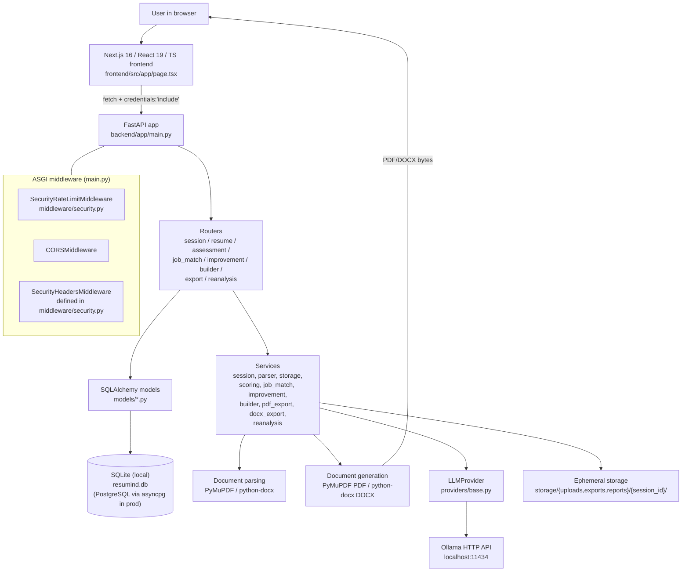
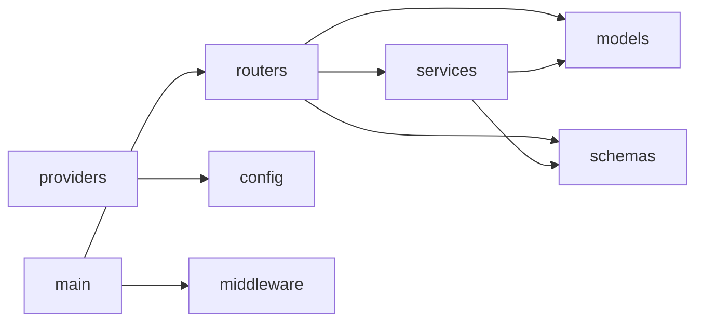
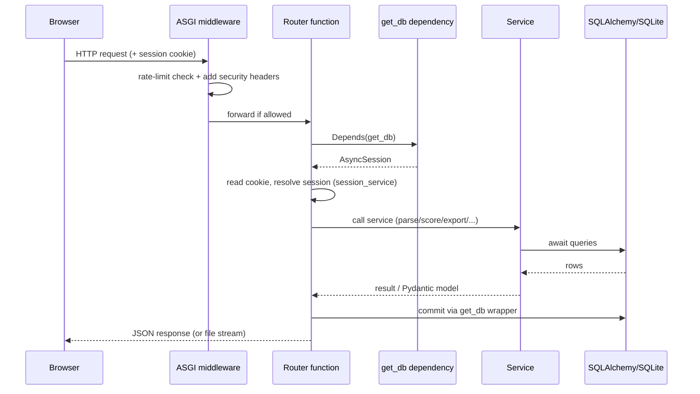
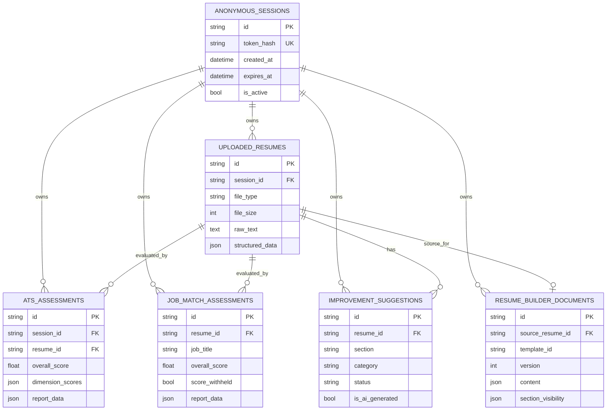
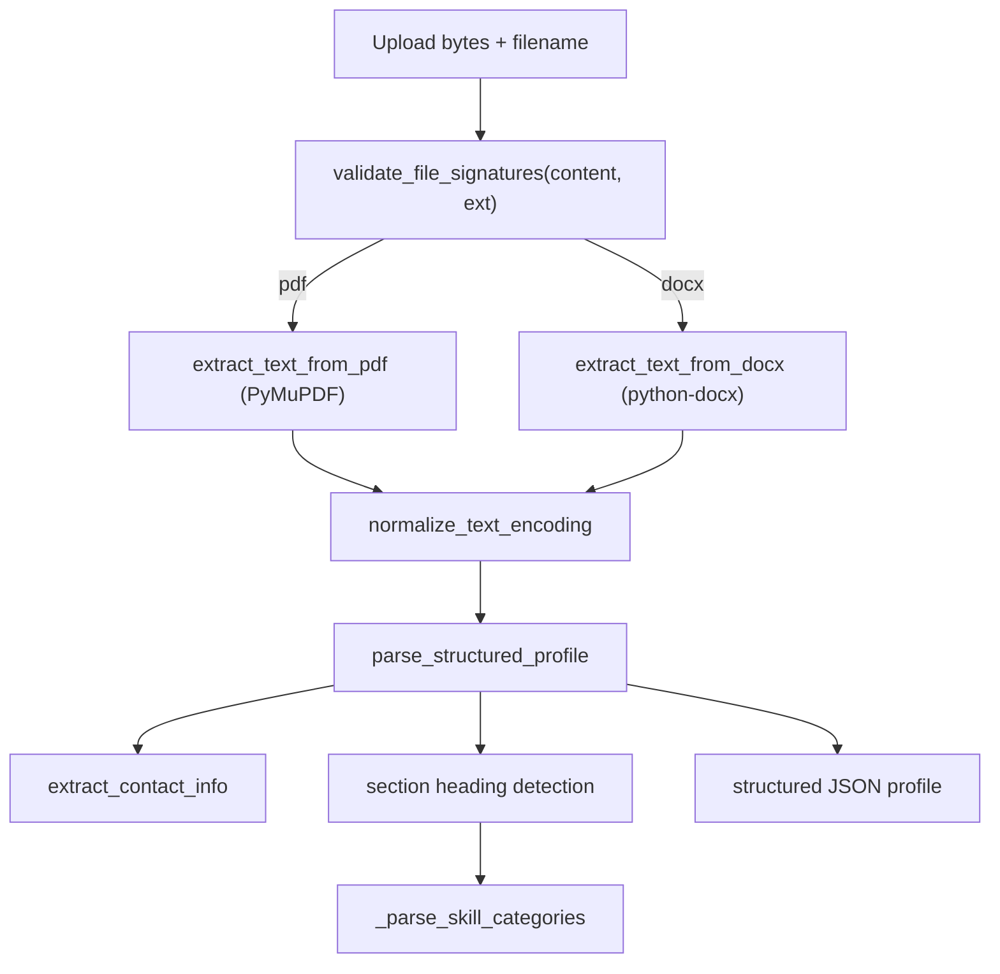
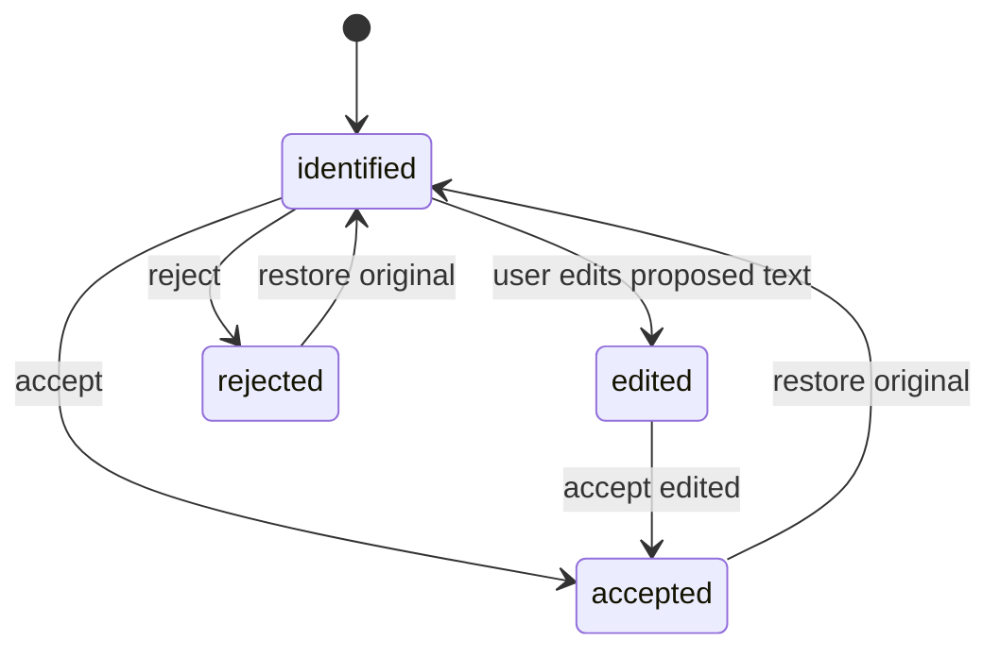
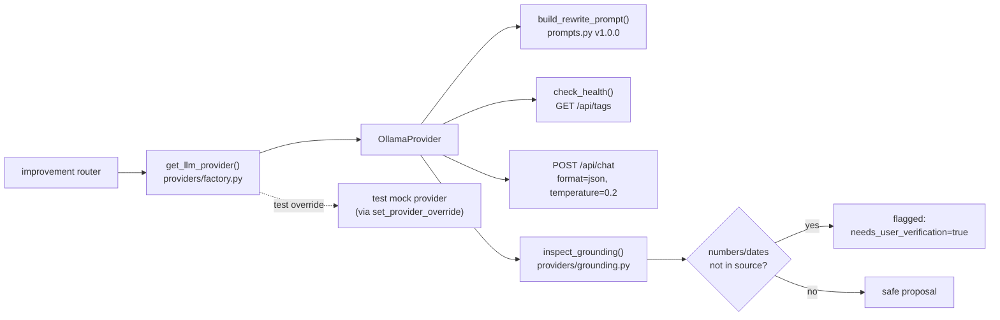
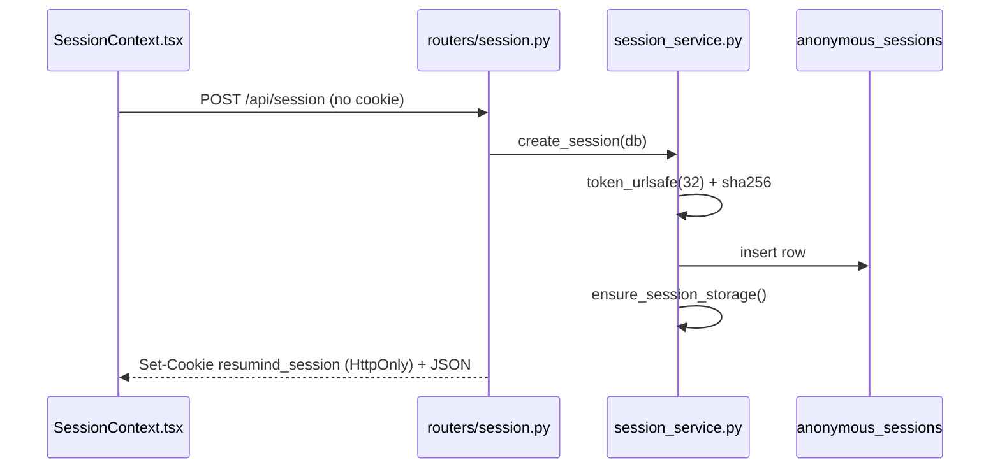
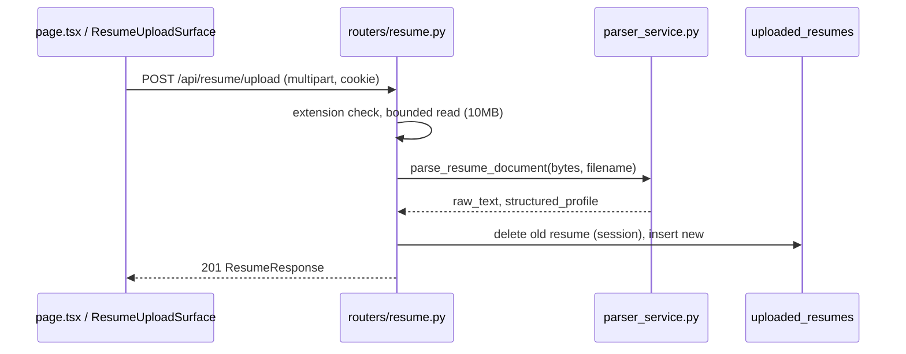

# RESUMIND AI — Complete Project Learning Guide

> An independent, source-verified architectural and educational reference for the
> RESUMIND AI codebase in this repository.
>
> **Analysis basis:** the executable source in `backend/` and `frontend/` as it currently
> exists, cross-checked against the project documents. Where documentation and code
> disagree, the discrepancy is reported explicitly.
>
> **Scope:** documentation only. No application source file was modified in producing
> this guide; no database, environment secret, dependency, or Git history was changed.

## Table of Contents

1. [How to read this guide](#1-how-to-read-this-guide)
2. [Executive overview](#2-executive-overview)
3. [System architecture](#3-system-architecture)
4. [Repository and folder structure](#4-repository-and-folder-structure)
5. [Frontend deep dive](#5-frontend-deep-dive)
6. [Backend deep dive](#6-backend-deep-dive)
7. [Database architecture](#7-database-architecture)
8. [Resume parsing engine](#8-resume-parsing-engine)
9. [ATS Readiness scoring engine](#9-ats-readiness-scoring-engine)
10. [Job description matching engine](#10-job-description-matching-engine)
11. [Improvement Studio and generative AI](#11-improvement-studio-and-generative-ai)
12. [Resume Builder](#12-resume-builder)
13. [PDF and DOCX generation](#13-pdf-and-docx-generation)
14. [Reanalysis and differential comparison](#14-reanalysis-and-differential-comparison)
15. [Security and privacy](#15-security-and-privacy)
16. [End-to-end flows](#16-end-to-end-flows)
17. [Testing and debugging](#17-testing-and-debugging)
18. [Local development guide](#18-local-development-guide)
19. [Interview and career preparation](#19-interview-and-career-preparation)
20. [Learning curriculum](#20-learning-curriculum)
21. [Known limitations and technical debt](#21-known-limitations-and-technical-debt)
22. [Source references and accuracy notes](#22-source-references-and-accuracy-notes)

---

## 1. How to read this guide

This guide has two audiences sharing one document:

- **You, the project owner**, who built this with AI coding agents and wants to actually
  understand it. Read Part by Part. Each Part starts with a plain-language summary, then
  goes deeper.
- **A software engineer reviewing your work**, who wants precise technical claims with
  file references.

A convention used throughout:

- `path/to/file.py` refers to a real file in the repository.
- "**Source shows**" means the claim was read directly from code.
- "**Not confirmed from current source**" means something was expected or documented but
  the running code does not prove it.
- Line numbers are approximate anchors from the current snapshot; they may drift as the
  code changes.

> **Honesty note.** Some project documents (for example `docs/PRODUCT_SPEC.md` and
> `docs/IMPLEMENTATION_PLAN.md`) were written *before* the code as specifications. The
> code is the source of truth for "what exists". This guide calls out every place where
> the specification and the implementation differ.

---

## 2. Executive overview

### 2.1 Plain-language explanation

RESUMIND AI is a website that helps a job seeker improve a resume. You upload a PDF or
Word document. The app reads it, shows you what it thinks your resume says so you can
correct mistakes, gives you a **format-and-parseability report card** (called ATS
Readiness), optionally compares your resume against a specific job posting (called Job
Match), suggests stronger bullet points, lets you edit a clean final version, and lets you
download it as a PDF or DOCX plus a diagnostic report.

There is **no account and no password**. The first time you visit, the server quietly gives
your browser a private "session" and remembers your work only for that browser, then
throws it away later.

Crucially, the app is designed **not** to invent facts about you. It will not claim you
have a skill or a metric you did not write. When it suggests a rewrite, it asks you to
accept, reject, or edit it.

### 2.2 Technical explanation

RESUMIND AI is a two-part web application:

- A **Next.js 16 / React 19 / TypeScript** single-page frontend (`frontend/`) that
  manages the whole user journey as a client-side view machine in
  `frontend/src/app/page.tsx`.
- A **FastAPI / SQLAlchemy (async) / Pydantic v2** backend (`backend/`) exposing a JSON
  REST API under `/api/*`, persisting to **SQLite** locally via `asyncpg`/`aiosqlite`
  drivers and **Alembic** migrations.

Document processing uses **PyMuPDF** (PDF text extraction and PDF generation) and
**python-docx** (DOCX extraction and generation). The optional AI rewrite feature talks to
a **local Ollama** server through an abstract `LLMProvider` interface
(`backend/app/providers/`). Anonymity is implemented with a high-entropy token in an
HttpOnly cookie whose SHA-256 hash is stored in the database (`backend/app/services/session_service.py`).

The scoring engines (`scoring_service.py`, `job_match_service.py`) are **deterministic,
rule-based heuristics**, not machine-learning models. There is no neural network trained
for scoring, and no embeddings/vector database in the current code.

### 2.3 The 60-second interview answer

> "RESUMIND AI is a privacy-first resume tool built as a Next.js frontend and a FastAPI
> backend. It parses PDF/DOCX resumes with PyMuPDF and python-docx, then scores them on a
> transparent five-dimension ATS Readiness formula and an optional four-dimension Job Match
> formula — both deterministic heuristics so results are reproducible and explainable. Users
> work in an anonymous session backed by an HttpOnly cookie whose SHA-256 hash is the only
> thing stored server-side. Improvement suggestions are either rule-based rewrites or
> grounded proposals from a local Ollama model behind an abstract provider interface, and the
> model's output passes a grounding check that flags any number or date not present in the
> original bullet. The final resume is rendered to a single-column ATS-safe PDF and DOCX
> from a saved Builder document with optimistic-concurrency versioning. It runs fully
> locally: SQLite, local Ollama, no paid APIs."

---

## 3. System architecture

### 3.1 Technology inventory (what is actually used, and where)

| Technology | Where it appears | What it does here | Why it is present |
| :--- | :--- | :--- | :--- |
| **Next.js 16 App Router** | `frontend/package.json` (`next: 16.4.3`), `frontend/src/app/` | Serves the React app; builds static routes | Modern React framework with file-based routing, bundling, and a production build step |
| **React 19** | `frontend/src/app/page.tsx`, `context/`, `components/` | UI rendering, state, effects | Component model for the interactive journey |
| **TypeScript** | all `frontend/src/**/*.ts(x)` | Static typing | Catches mistakes before runtime; `tsc --noEmit` is a checked gate |
| **Tailwind CSS 4** | `frontend/src/app/globals.css` + `className` strings | Utility styling | Fast, consistent styling; implements the *Frost & Chrome* tokens as literal hex values |
| **Python 3.11+** | `backend/` | Backend language | Async-first ecosystem for FastAPI |
| **FastAPI** | `backend/app/main.py`, `routers/*.py` | HTTP API, routing, DI | Async, typed, auto OpenAPI docs |
| **Pydantic v2** | `backend/app/schemas/*.py`, `config.py` | Request/response validation, settings | Runtime validation + typed config |
| **pydantic-settings** | `backend/app/config.py` | Loads config from env / `.env` | Centralised settings |
| **SQLAlchemy 2.0 async** | `backend/app/database.py`, `models/*.py` | ORM + async sessions | Typed ORM with async DB access |
| **SQLite (aiosqlite)** | `DATABASE_URL` default `sqlite+aiosqlite:///./resumind.db` | Local database | Zero-install local persistence |
| **PostgreSQL (asyncpg)** | `requirements.txt`; `config.py` production validator | Production DB driver | Documented production target; **not exercised locally** |
| **Alembic** | `backend/alembic/` | Schema migrations | Versioned schema evolution |
| **PyMuPDF (`pymupdf`)** | `parser_service.py`, `pdf_export_service.py`, `reanalysis_service.py` | PDF text extraction + PDF generation | Reads and writes PDFs, selectable text |
| **python-docx** | `parser_service.py`, `docx_export_service.py` | DOCX extraction + DOCX generation | Native Word document handling |
| **Ollama** | `backend/app/providers/ollama_provider.py` | Local LLM inference over HTTP | Optional, free, local AI rewrites |
| **`LLMProvider` abstraction** | `backend/app/providers/base.py`, `factory.py` | Pluggable provider | Testability and no vendor lock-in |
| **httpx** | `ollama_provider.py`; tests | Async HTTP client | Calls Ollama; API test client |
| **pytest / pytest-asyncio** | `backend/tests/` | Backend tests | Behaviour verification |
| **Playwright** | `frontend/scripts/launch-gate-e2e.mjs`, `package.json` | Browser E2E launch gate | Real-browser verification |
| **ESLint** | `frontend/package.json` (`eslint`) | Lint | Code-quality gate |
| **Motion** (formerly Framer Motion) | **Not found as a dependency** | — | Specification mentions it; current `package.json` does not include it (discrepancy) |

> **Documentation vs. code discrepancy #1.** `AGENTS.md` lists "Motion" and the spec lists
> "shadcn/ui, Radix UI primitives". The current `frontend/package.json` declares only
> `next`, `react`, `react-dom` as runtime dependencies and Tailwind/ESLint/Playwright/
> TypeScript as dev dependencies. **Source shows** no Motion or shadcn/ui or Radix usage.
> Treat those as aspirational unless added later.

> **Documentation vs. code discrepancy #2.** The spec's Screen 8 mentions "headless vector
> engine or print styling" and `PRODUCT_SPEC.md` lists "ReportLab or another actual PDF
> library" as a possibility. **Source shows** PDFs are generated with **PyMuPDF itself**
> (`pdf_export_service.py`, `import pymupdf as fitz`). There is no ReportLab in
> `requirements.txt`.

### 3.2 Architecture diagram (verified against the source)



What the diagram deliberately **omits** (because it does not exist in the code): any cloud
LLM, any vector database, any background worker/queue, any authentication service.

### 3.3 Synchronous vs asynchronous communication

- **Browser → API:** asynchronous HTTP. Every call in the frontend uses `fetch(...)` with
  `credentials: "include"`, so the HttpOnly session cookie is sent. Example:
  `frontend/src/app/page.tsx` upload handler and `runAssessment`.
- **API → database:** asynchronous. SQLAlchemy's `AsyncSession` is yielded by the `get_db`
  dependency (`backend/app/database.py`) and every query is `await`ed.
- **API → Ollama:** asynchronous HTTP via `httpx.AsyncClient`
  (`ollama_provider.py`), with connect and generation timeouts.
- **API → disk (upload/export):** standard blocking file I/O inside async handlers
  (`resume.py` writes uploads with `open(..., "wb")`). This is acceptable for small files
  but is technically blocking work inside an async function.
- **API → parsers:** parsing is synchronous, CPU-bound Python called directly from the
  async handler (`parse_resume_document`). See limitations in Part 21.

### 3.4 Core web concepts, in this project's terms

- **HTTP**: the request/response protocol between the browser and the API.
- **REST API**: the API exposes resources with URLs and verbs — e.g. `POST /api/session`,
  `POST /api/resume/upload`, `PUT /api/resume`, `GET /api/export/resume/pdf`.
- **JSON**: the data format for API bodies and responses (Pydantic models serialise to JSON).
- **Cookies**: the API sets `resumind_session` as an **HttpOnly** cookie so JavaScript
  cannot read it; the browser attaches it automatically (`routers/session.py`).
- **CORS**: because the frontend (`:3000`) and API (`:8000`) are different origins, the
  API must allow the frontend origin explicitly (`main.py`, `settings.cors_origin_list`).
- **Client vs server rendering**: `page.tsx` begins with `"use client"`, so the journey is
  rendered in the browser; `layout.tsx` is a server component wrapper that mounts providers.

---

## 4. Repository and folder structure

### 4.1 Top-level tree

```text
RESUMIND-AI/
├── AGENTS.md                     # Agent governance / project rules
├── README.md                     # Entry point, setup, limitations
├── .gitignore                    # Excludes generated/local data
├── docs/                         # Specifications, audits, and (now) this guide
├── scripts/                      # PowerShell setup/test/start helpers
├── backend/
│   ├── app/
│   │   ├── main.py               # FastAPI app, middleware, lifespan, router mounting
│   │   ├── config.py             # pydantic-settings Settings
│   │   ├── database.py           # async engine, session factory, get_db
│   │   ├── models/               # SQLAlchemy ORM models
│   │   ├── schemas/              # Pydantic request/response models
│   │   ├── routers/              # API route modules
│   │   ├── services/             # Business logic / engines
│   │   ├── providers/            # LLM provider abstraction + Ollama + grounding
│   │   └── middleware/           # security.py (rate limit + headers)
│   ├── alembic/                  # migration environment + versions/
│   ├── tests/                    # pytest suite + synthetic_generator.py
│   ├── requirements.txt
│   ├── pytest.ini
│   └── resumind.db               # local SQLite (git-ignored)
├── frontend/
│   ├── src/app/                  # App Router: layout.tsx, page.tsx, globals.css
│   ├── src/components/           # Product screens (client components)
│   ├── src/context/              # SessionContext, ThemeContext
│   ├── src/lib/api.ts            # API base URL resolution
│   ├── scripts/launch-gate-e2e.mjs
│   ├── public/
│   └── package.json
└── storage/                      # runtime data (uploads/exports/reports), git-ignored contents
```

### 4.2 Backend files — responsibility map

| File | Responsibility | Called by | Key dependencies | If it failed |
| :--- | :--- | :--- | :--- | :--- |
| `backend/app/main.py` | Builds the FastAPI app, mounts middleware and all routers, runs startup/lifespan tasks | Uvicorn (indirectly, whole app) | `config`, `middleware`, `database`, all routers | Nothing works; the API does not start |
| `backend/app/config.py` | Typed settings; production validation; boolean env hardening | Imported nearly everywhere | `pydantic-settings` | App cannot read config at startup |
| `backend/app/database.py` | Creates async engine, session factory, `get_db` dependency | All routers | SQLAlchemy async | No DB access; every data route fails |
| `backend/app/models/*.py` | ORM tables and relationships | Routers/services via queries | SQLAlchemy | Data cannot be persisted/queried |
| `backend/app/schemas/*.py` | Request/response contracts + validation | Routers | Pydantic | Requests rejected or responses malformed |
| `backend/app/routers/session.py` | Anonymous session create/reuse/reset | Frontend `SessionContext` | `session_service` | No session → most endpoints 401 |
| `backend/app/routers/resume.py` | Upload + parse + persist; get/update resume | Upload surface, review screen | `parser_service`, `storage_service` | Cannot ingest resumes |
| `backend/app/routers/assessment.py` | Compute/persist ATS assessment | ATS report view | `scoring_service` | No readiness report |
| `backend/app/routers/job_match.py` | Compute/persist Job Match | Job match view | `job_match_service` | No job match |
| `backend/app/routers/improvement.py` | Generate/accept/reject/edit suggestions; AI rewrite; provider status | Improvement Studio | `improvement_service`, `providers` | No suggestions/rewrites |
| `backend/app/routers/builder.py` | Get/save/reset Builder document with version check | Builder screen, export | `builder_service` | Cannot save the final resume |
| `backend/app/routers/export.py` | Stream PDF/DOCX resume + diagnostic report | Export Center | `pdf_export_service`, `docx_export_service` | Cannot download outputs |
| `backend/app/routers/reanalysis.py` | Baseline vs revision comparison | Export Center | `reanalysis_service` | No differential view |
| `backend/app/services/session_service.py` | Token mint/hash, lifecycle, cleanup | Session router, `main.py` cleanup loop, every router | `models`, `storage_service` | Sessions invalid/never expire |
| `backend/app/services/storage_service.py` | Path-safe per-session dirs | Resume/export services | `pathlib` | Path traversal risk / storage errors |
| `backend/app/services/parser_service.py` | Validate, extract, normalise, structure resume | Resume router | PyMuPDF, python-docx | Empty/broken extraction |
| `backend/app/services/scoring_service.py` | 5-dimension ATS heuristic | Assessment router, reanalysis | none external (pure Python/regex) | No ATS score |
| `backend/app/services/job_match_service.py` | 4-dimension grounded job match | Job match router, reanalysis | pure Python/regex | No job match |
| `backend/app/services/improvement_service.py` | Rule-based suggestion generation, apply/restore | Improvement router | `models` | No suggestions / cannot apply edits |
| `backend/app/services/builder_service.py` | Convert profile ↔ Builder content | Builder router, reanalysis | `schemas` | Builder cannot initialise/save |
| `backend/app/services/pdf_export_service.py` | Render Builder → PDF | Export router, reanalysis | PyMuPDF | PDF export fails |
| `backend/app/services/docx_export_service.py` | Render Builder → DOCX | Export router | python-docx | DOCX export fails |
| `backend/app/services/reanalysis_service.py` | Compare baseline vs saved revision | Reanalysis router | scoring, job match, pdf_export | Reanalysis unavailable |
| `backend/app/providers/base.py` | Provider ABC + exceptions + dataclasses | Factory, Ollama, router | Pydantic | No AI contract |
| `backend/app/providers/factory.py` | Choose provider (override-aware) | Improvement router, tests | `ollama_provider` | Cannot resolve a provider |
| `backend/app/providers/ollama_provider.py` | Health + rewrite via Ollama | Factory | `httpx`, `prompts`, `grounding` | Rewrites fail gracefully |
| `backend/app/providers/prompts.py` | Versioned prompt templates | Ollama provider | — | Prompt contract missing |
| `backend/app/providers/grounding.py` | Hallucination/grounding checks | Ollama provider, tests | regex | Unsafe rewrites could pass |
| `backend/app/middleware/security.py` | Sliding-window rate limit + security headers | `main.py` | Starlette ASGI | Abuse protection/headers lost |

> **Important note about middleware.** `main.py` adds **`SecurityRateLimitMiddleware`** and
> **`CORSMiddleware`**. `SecurityHeadersMiddleware` is *defined* in `security.py` but the
> current `main.py` does **not** mount it. In practice the rate-limit middleware already
> injects the same baseline security headers on responses, so headers are still applied —
> but the dedicated header-only middleware class is effectively unused. This is a
> duplication worth cleaning up later (see Part 21).

### 4.3 Frontend files — responsibility map

| File | Responsibility | Notes |
| :--- | :--- | :--- |
| `frontend/src/app/layout.tsx` | Root HTML shell; mounts `ThemeProvider` and `SessionProvider` | Server component |
| `frontend/src/app/page.tsx` | The whole journey state machine (`upload → review → ats_report → job_match_report → improvement_studio → builder → export`) | `"use client"` |
| `frontend/src/context/SessionContext.tsx` | Mints/reuses the anonymous session; tracks `backendOnline` | `"use client"` |
| `frontend/src/context/ThemeContext.tsx` | Light/dark theme state and toggle | `"use client"` |
| `frontend/src/lib/api.ts` | Resolves API base URL, aligning loopback hostnames so the cookie stays same-site | Pure function |
| `components/Header.tsx` | Brand bar, theme toggle, "start fresh" | Client component |
| `components/ResumeUploadSurface.tsx` | Drag/drop + file selection + upload call | Client component |
| `components/AnalysisModeSelector.tsx` | Choose ATS-only vs Job-Match flow; JD textarea | Client component |
| `components/ResumeReviewScreen.tsx` | Editable structured profile review | Client component |
| `components/ATSReportView.tsx` | Score + dimensions + findings | Client component |
| `components/JobMatchReportView.tsx` | Job match score + requirement matrix | Client component |
| `components/ImprovementStudioView.tsx` | Suggestions + AI rewrite + accept/reject/edit | Client component |
| `components/ResumeBuilderView.tsx` | Editing panes + live preview + save | Client component |
| `components/ExportCenterView.tsx` | Download buttons + reanalysis panel | Client component |
| `components/SignatureIllustration.tsx` | Decorative hero SVG | Client component (visual only) |

> **Correction to the README.** The README's "Project structure" block still lists a
> top-level `tests/` shared fixture directory. That placeholder was removed during the
> clean-up pass because the backend tests use `backend/tests/fixtures/` (see
> `backend/tests/synthetic_generator.py`). If you see `tests/` in the README, treat it as
> stale.

### 4.4 Ownership / dependency direction



Rule of thumb: **routers orchestrate, services compute, models persist, schemas validate.**
A service never imports a router; a model never imports a service.

### 4.5 Unused, duplicate or historical files (findings, not deletions)

- `backend/app/middleware/security.py` defines `SecurityHeadersMiddleware` that `main.py`
  does not mount (headers do arrive via the rate-limit middleware).
- `frontend/src/app/page.tsx` handles all screens in one file; there are no per-route
  pages (`/review`, `/readiness`, etc.) even though `PRODUCT_SPEC.md` describes URL routes.
  Navigation is **in-memory state**, not URL routing.
- `pdf_export_service.py` retains a `FONT_MAP` with `merriweather` and `roboto_mono`
  options, while the Builder enforces the single `ats_professional` template.
- `docs/REPAIR_REPORT.md` is explicitly historical and superseded.

---

## 5. Frontend deep dive

### 5.1 The concepts, one at a time

**Next.js** is a framework built on React that bundles your components into a web app and
provides routing and a production build (`next build`). Here it produces static routes
`/`, `/_not-found`, and a `/rewrite` route (see the launch-readiness build note).

**React** is a JavaScript library for building UI from **components**. A component is a
function returning JSX (HTML-like markup). In this project one huge component,
`Home` in `page.tsx`, owns the current screen.

**TypeScript** adds types to JavaScript. For example `type AppView = "upload" | "review" | ...`
declares that a view variable may only hold those exact strings — a typo is a compile error.

**The App Router** is Next.js's file-system router: files inside `src/app/` become routes.
`layout.tsx` wraps everything; `page.tsx` is the `/` route.

**Components, props, state**:

- **Props** are inputs passed to a component, e.g. `<ATSReportView assessment={assessmentData} ... />`.
- **State** is data a component remembers between renders, created with `useState`.

**Hooks** are functions starting with `use`. `useState` stores state, `useEffect` runs code
after render (e.g. restore a session), `useCallback` memoises a function, `useContext`
reads shared context, `useRef` stores a value without re-rendering.

**Context providers** share data without passing props down every level. `SessionProvider`
puts the session and `backendOnline` where any child can read them via `useSession()`.

### 5.2 The session provider (shared state)

`frontend/src/context/SessionContext.tsx`:

```tsx
const res = await fetch(`${apiBaseUrl}/api/session`, {
  method: "POST",
  credentials: "include", // essential for the HttpOnly cookie
  headers: { "Content-Type": "application/json" },
});
const data: SessionInfo = await res.json();
setSession(data);
setBackendOnline(true);
```

Line by line:

1. `fetch(...)` sends an async HTTP request to the backend.
2. `method: "POST"` — the session endpoint creates-or-reuses a session.
3. `credentials: "include"` tells the browser to send *and* accept cookies, which is what
   makes the anonymous session work cross-origin in local dev.
4. `.json()` parses the JSON body into a JS object.
5. `setSession` / `setBackendOnline` update React state, causing a re-render.
6. On failure it sets `backendOnline = false` so the UI can degrade gracefully instead of
   crashing.

`initializedRef` guards against React Strict Mode running the effect twice in development.

### 5.3 How API calls are made

Every call goes through the same pattern: `getApiBaseUrl()` → `fetch` → check `res.ok`
→ parse JSON → set state → render. `frontend/src/lib/api.ts` is important:

```ts
if (loopbackHosts.has(parsed.hostname) && loopbackHosts.has(window.location.hostname)) {
  parsed.hostname = window.location.hostname;
}
```

This makes the API hostname match the page's hostname (`localhost` vs `127.0.0.1`). Because
cookies are bound to a host, mixing them would break the session — a subtle but crucial
detail.

### 5.4 The view machine (navigation)

Navigation is a `useState` string, not a URL route:

```tsx
type AppView = "upload" | "review" | "ats_report" | "job_match_report"
             | "improvement_studio" | "builder" | "export";
const [appView, setAppView] = useState<AppView>("upload");
```

Each handler (`handleLaunchBuilder`, `handleBackToReview`, etc.) calls `setAppView(...)`.
On reload, `restoreActiveSession()` calls `GET /api/resume` and `GET /api/export/status` to
re-open the right screen — so a refresh does not lose the user's place.

Why this matters: it is a **single-page client application**. The browser back button does
not move between screens the way it would on separate pages. That is a real UX/architecture
trade-off to mention in interviews (see Part 21).

### 5.5 Loading and error states

Each async flow has three states: `isEvaluating` / `isJobMatching` (loading),
`evaluationError` / `jobMatchError` (error string), and the data itself. Example from
`runAssessment`:

```tsx
setIsEvaluating(true);
try { /* fetch */ setAssessmentData(data); }
catch (err) { setEvaluationError(msg); }
finally { setIsEvaluating(false); }
```

Passing `isLoading` and `errorMessage` into `ATSReportView` lets that component render a
spinner or an error card with a Retry action (`onRetry={handleRetryAssessment}`).

### 5.6 The theme system and Frost & Chrome tokens

`ThemeProvider` toggles a `dark` class on the document. The design tokens are expressed as
literal colour classes, e.g. in `page.tsx`:

```tsx
className="... bg-[#F3F5F6] text-[#181A1D] ... dark:bg-[#0E1013] dark:text-[#F0F2F5]"
```

- Pearl Canvas `#F3F5F6` / Obsidian `#0E1013`
- Primary Ink `#181A1D` / Off-White `#F0F2F5`
- Secondary text `#58616D` / `#A0ABB8` (roughly Chrome Silver range)

> **Observation.** `DESIGN_SYSTEM.md` names tokens (`pearl-canvas`, `chrome-silver`,
> `steel-blue`, `frosted-surface`). The code mostly uses **hard-coded hex values** rather
> than named Tailwind tokens. The visual result follows the design but the token layer is
> not centralised as the design doc implies. This is a refactor opportunity, not a bug.

### 5.7 Screen-by-screen trace

| Screen (`appView`) | Component | Data in | Backend calls | Data out |
| :--- | :--- | :--- | :--- | :--- |
| `upload` | `ResumeUploadSurface` + `AnalysisModeSelector` | `selectedFile`, `analysisMode`, `jobDescription` | `POST /api/resume/upload` | `ParsedResume` → review |
| `review` | `ResumeReviewScreen` | `parsedResume` | `PUT /api/resume` on save | `StructuredProfile` → analysis |
| `ats_report` | `ATSReportView` | assessment data | `POST /api/assessment` | navigation only |
| `job_match_report` | `JobMatchReportView` | job match data | `POST /api/job-match` | navigation only |
| `improvement_studio` | `ImprovementStudioView` | `parsedResume` | `POST /api/improvement/generate`, `/{id}/rewrite`, suggestion actions | updated profile |
| `builder` | `ResumeBuilderView` | `parsedResume` | `GET/PUT /api/builder`, `POST /api/builder/reset` | saved doc → export |
| `export` | `ExportCenterView` | `parsedResume` | `GET /api/export/*`, `GET /api/reanalysis` | downloads |

### 5.8 A worked component example — reading a small excerpt

From `page.tsx`, the ATS run:

```tsx
const url = recalculate
  ? `${API_BASE}/api/assessment?recalculate=true`
  : `${API_BASE}/api/assessment`;
const response = await fetch(url, {
  method: "POST",
  credentials: "include",
  headers: { "Content-Type": "application/json" },
});
const data: ATSAssessmentData = await response.json();
setAssessmentData(data);
```

1. `recalculate` decides whether to reuse a cached assessment or force a new one.
2. `POST` with credentials includes the session cookie.
3. On success the parsed JSON is stored in state.
4. React re-renders `ATSReportView` with the new `assessment` prop.

How data leaves: the user then clicks "Improvement Studio" or "Builder", which only change
`appView`; the data itself stays in `parsedResume`/`assessmentData`.

---

## 6. Backend deep dive

### 6.1 Python concepts used here

- **Modules and packages**: `app/` is a package; each `.py` file is a module. `app.services.scoring_service` is a module path.
- **Functions and classes**: `calculate_ats_score(...)` is a function; `ATSReport`, `DimensionResult` are Pydantic classes.
- **Type annotations**: `raw_text: str`, `-> ATSReport` document types; FastAPI uses them to validate and generate docs.
- **async / await**: `async def get_db()` declares a coroutine; `await db.execute(...)` yields control while waiting on I/O so other requests can proceed.
- **Pydantic**: `BaseModel` subclasses validate input; a bad payload yields HTTP 422 before your code runs.
- **Dependency injection**: `db: AsyncSession = Depends(get_db)` asks FastAPI to call `get_db` and supply the result.

### 6.2 Request lifecycle (verified)



Note: `get_db` commits after the handler returns successfully and rolls back on exception
(`backend/app/database.py`). Some routers also call `await db.commit()` explicitly (e.g.
`resume.py`, `assessment.py`); committing twice is harmless but slightly redundant.

### 6.3 Configuration and environment variables

`backend/app/config.py` defines `Settings`. Key fields (defaults):

| Variable | Default | Purpose |
| :--- | :--- | :--- |
| `APP_ENV` | `development` | Switches production validation on |
| `DEBUG` | `True` | Debug flag (hardened boolean parsing) |
| `DATABASE_URL` | `sqlite+aiosqlite:///./resumind.db` | DB connection (secret-ish; `repr=False`) |
| `CORS_ORIGINS` | `http://localhost:3000,http://127.0.0.1:3000` | Allowed browser origins |
| `SESSION_COOKIE_*` | secure=False, httponly=True, samesite=lax | Cookie behaviour |
| `SESSION_TTL_HOURS` | `24` | Inactivity window |
| `SESSION_CLEANUP_INTERVAL_SECONDS` | `3600` | Background cleanup cadence |
| `RATE_LIMIT_*` | 60/min API, 5 uploads, 10 AI | Quotas |
| `STORAGE_ROOT` | repo `storage/` | Ephemeral file root |
| `OLLAMA_BASE_URL` | `http://localhost:11434` | Local Ollama endpoint |
| `OLLAMA_MODEL` | `llama3.2` | Model name |
| `OLLAMA_*_TIMEOUT_SEC`, `OLLAMA_MAX_RETRIES` | 5.0 / 120.0 / 1 | Timeouts, retry |

When `APP_ENV=production`, the `validate_production_settings` validator **fails closed**
unless debug is off, the cookie is secure+httponly+samesite lax/strict, rate limiting is on,
the DB uses `postgresql+asyncpg://`, and CORS origins are explicit HTTPS.

> **Fix applied during the recent clean-up.** A machine-level `DEBUG=release` environment
> variable (set by unrelated tooling) used to crash startup because pydantic-settings matches
> field names case-insensitively. `config.py` now coerces recognised boolean strings and,
> outside production, ignores unrecognised values with a logged warning. In production an
> unrecognised value still fails closed. This behaviour is covered by
> `backend/tests/test_config.py`.

### 6.4 Complete API reference (verified from routers)

All routes are mounted under `/api`. Every protected route reads the session cookie
`resumind_session` and returns **401** when it is missing/expired.

| Method | Path | Router | Purpose | Auth | Success | Common errors |
| :--- | :--- | :--- | :--- | :--- | :--- | :--- |
| GET | `/api/health` | `main.py` | Liveness | none | 200 JSON status | — |
| POST | `/api/session` | `session.py` | Create or reuse an anonymous session | cookie optional | 200 `SessionResponse` | 500 |
| GET | `/api/session` | `session.py` | Inspect current session | cookie | 200 | **401** |
| POST | `/api/session/reset` | `session.py` | Revoke + purge files | cookie | 200 `SessionResetResponse` | — |
| POST | `/api/resume/upload` | `resume.py` | Upload, parse, persist a resume | cookie | **201** `ResumeResponse` | 400 bad type/empty, 413 too large, 422 parse fail, 500 |
| GET | `/api/resume` | `resume.py` | Get active resume profile | cookie | 200 | 401/404 |
| PUT | `/api/resume` | `resume.py` | Save reviewed corrections | cookie | 200 | 401/404/422 |
| DELETE | `/api/resume` | `resume.py` | Delete the active resume for this session | cookie | 200/204 | 401/404 |
| POST | `/api/assessment` | `assessment.py` | Compute/persist ATS readiness (`?recalculate=`) | cookie | 200 `ATSAssessmentResponse` | 401/404 |
| GET | `/api/assessment` | `assessment.py` | Fetch latest/current assessment | cookie | 200 | 401/404 |
| POST | `/api/job-match` | `job_match.py` | Compute Job Match for a JD | cookie | 200 | 401/404/422 (short JD) |
| GET | `/api/job-match` | `job_match.py` | Fetch latest job match | cookie | 200 | 401/404 |
| POST | `/api/improvement/generate` | `improvement.py` | Generate rule-based suggestions (`?force_regenerate=`) | cookie | 200 `ImprovementSummaryResponse` | 401/404 |
| GET | `/api/improvement` | `improvement.py` | List suggestions | cookie | 200 | 401/404 |
| PUT | `/api/improvement/{suggestion_id}` | `improvement.py` | Accept / reject / edit a suggestion | cookie | 200 | 401/404/409 (stale) |
| POST | `/api/improvement/batch-accept` | `improvement.py` | Batch accept high-confidence | cookie | 200 `BatchAcceptResponse` | 401/404 |
| POST | `/api/improvement/{id}/restore` | `improvement.py` | Restore original text | cookie | 200 | 401/404 |
| POST | `/api/improvement/{id}/rewrite` | `improvement.py` | AI rewrite proposal (Ollama) | cookie | 200 `ImprovementSuggestionSchema` | 401/404/502/504 |
| GET | `/api/improvement/provider/status` | `improvement.py` | Check Ollama availability | cookie | 200 `AIProviderStatusResponse` | 401 |
| GET | `/api/builder` | `builder.py` | Fetch Builder document | cookie | 200 | 401/404 |
| PUT | `/api/builder` | `builder.py` | Save content/settings (optimistic version) | cookie | 200 | 401/**404**/**409 conflict**/400 |
| POST | `/api/builder/reset` | `builder.py` | Reset from resume or blank | cookie | 200 | 401 |
| GET | `/api/export/status` | `export.py` | Report what is export-ready | cookie | 200 | — |
| GET | `/api/export/resume/pdf` | `export.py` | Download PDF (`?version=`) | cookie | 200 `application/pdf` | 401/404/409/422 |
| GET | `/api/export/resume/docx` | `export.py` | Download DOCX (`?version=`) | cookie | 200 DOCX | 401/404/409/422 |
| GET | `/api/export/report/pdf` | `export.py` | Download diagnostic report PDF | cookie | 200 PDF | 401/404 |
| GET | `/api/reanalysis` | `reanalysis.py` | Baseline vs saved revision comparison | cookie | 200 `ReanalysisResponse` | 401 (locked state returned as 200 with `available=false`) |

> The exact subset of HTTP codes above was confirmed by reading each router. Where a
> particular error path is not exercised by tests, this guide does not claim it is "tested",
> only that the code path exists.

### 6.5 Error handling, middleware and configuration

- **Error handling:** routers raise `HTTPException` with a `detail` message. Parser errors
  are mapped to specific codes (413/400/422) and the partially written upload is deleted
  (`resume.py`).
- **Middleware:** `SecurityRateLimitMiddleware` runs an in-process sliding-window limiter
  keyed by client IP (general) and by hashed session token for uploads/AI. It returns
  **429** with `Retry-After` and injects `X-Content-Type-Options`, `X-Frame-Options`,
  `Referrer-Policy`, `Permissions-Policy`, and HSTS in production. `CORSMiddleware` wraps it
  so rejected responses still get CORS headers (`main.py` comments explain this).
- **Lifespan:** on startup it creates tables when not in production and starts a periodic
  expired-session cleanup task; it cancels the task cleanly on shutdown.

---
## 7. Database architecture

### 7.1 ORM models (verified)

All primary keys are UUID strings (`String(36)`). Every child table carries `session_id`
with `ondelete="CASCADE"` and a cascade ORM relationship, so deleting a session removes its
data.

| Table | Model file | Key columns | Relationships |
| :--- | :--- | :--- | :--- |
| `anonymous_sessions` | `models/session.py` | `id` (PK), `token_hash` (unique, indexed), `created_at`, `last_seen_at`, `expires_at` (indexed), `is_active` | 1 → many resumes, assessments, job_matches, improvements, builder_documents |
| `uploaded_resumes` | `models/resume.py` | `id` (PK), `session_id` (FK), `filename`, `file_type`, `file_size`, `storage_filename`, `raw_text` (Text), `structured_data` (JSON), timestamps | → session; → many assessments, job_matches, improvements |
| `ats_assessments` | `models/assessment.py` | `id`, `session_id`, `resume_id`, `overall_score`, `dimension_scores` (JSON), `report_data` (JSON) | → session, resume |
| `job_match_assessments` | `models/job_match.py` | `id`, `session_id`, `resume_id`, `job_title`, `job_description_raw`, `overall_score`, `score_withheld`, `report_data` (JSON) | → session, resume |
| `improvement_suggestions` | `models/improvement.py` | `id`, `session_id`, `resume_id`, `section`, `category`, `original_text`, `proposed_text`, `user_edited_text`, `status`, `is_ai_generated`, `ai_model`, `preserved_facts`, `potential_new_claims`, `needs_user_verification` | → session, resume |
| `resume_builder_documents` | `models/builder.py` | `id`, `session_id`, `source_resume_id`, `template_id`, `template_config` (JSON), `section_order` (JSON), `section_visibility` (JSON), `content` (JSON), `version` | → session, resume |

### 7.2 Entity-relationship diagram



### 7.3 JSON columns: why and what they hold

- `structured_data` stores the parsed profile (`contact`, `summary`, `experience`,
  `education`, `skills`, `skill_categories`, `projects`, `certifications`, `other`,
  `warnings`). SQLite stores it as text; SQLAlchemy maps it to Python dicts.
- `dimension_scores` and `report_data` snapshot the full ATS report so old assessments are
  reproducible even if scoring code changes later.
- `content`, `section_order`, `section_visibility`, `template_config` hold the editable
  Builder state.
- `preserved_facts` / `potential_new_claims` on suggestions store AI grounding metadata
  (deserialised defensively in `schemas/improvement.py`).

### 7.4 How an upload creates and links records

1. `POST /api/session` creates an `anonymous_sessions` row and provisions
   `storage/uploads/{session_id}/` (`session_service.create_session`).
2. `POST /api/resume/upload` parses the file, deletes any previous resume for that session,
   then inserts one `uploaded_resumes` row (`resume.py`).
3. `POST /api/assessment` inserts an `ats_assessments` row linked to both session and resume.
4. `POST /api/job-match` inserts a `job_match_assessments` row.
5. `POST /api/improvement/generate` inserts `improvement_suggestions` rows.
6. `PUT /api/builder` inserts/updates one `resume_builder_documents` row and increments
   `version`.

### 7.5 How anonymous sessions isolate data

Isolation is enforced in **query scoping**, not row-level security: every query filters by
`session_id == session.id`, where `session` comes from the cookie's token hash. A request
without a valid cookie cannot resolve a session and receives 401. This is covered by
cross-session isolation tests (see Part 17).

### 7.6 Migrations

`backend/alembic/` holds the environment and `versions/` the revision chain. The chain
applies cleanly to a fresh SQLite database (verified with an isolated temporary DB during
the recent clean-up). In non-production, `main.py` also calls `Base.metadata.create_all`
for convenience — acceptable locally, but **production must rely on Alembic**, as the
README states.

### 7.7 Safe SQLite inspection

Run these against a **copy** of the database, never the live file while the server is
running:

```powershell
cd backend
Copy-Item resumind.db resumind.inspect.db
.\.venv\Scripts\python.exe -c "import sqlite3;c=sqlite3.connect('resumind.inspect.db');print([r[0] for r in c.execute(\"select name from sqlite_master where type='table'\")])"
.\.venv\Scripts\python.exe -c "import sqlite3;c=sqlite3.connect('resumind.inspect.db');print(c.execute('select count(*) from anonymous_sessions').fetchone())"
Remove-Item resumind.inspect.db
```

Never dump `raw_text`, `structured_data`, or `token_hash` values into logs, chats, or
commits: they contain personal resume content and session secrets.

---

## 8. Resume parsing engine

The parser lives in `backend/app/services/parser_service.py`. Its public entry point is:

```python
def parse_resume_document(content: bytes, filename: str) -> Tuple[str, Dict[str, Any]]:
```

It returns `(raw_text, structured_profile)`.

### 8.1 The pipeline



### 8.2 File validation

- **Extension check** happens first in the router (`resume.py`): only `.pdf` and `.docx`.
- **Magic-byte/signature validation** happens in the parser (`validate_file_signatures`).
  A file whose content does not match its extension is rejected (`UnsupportedFileTypeError`).
- **Size limit**: the router reads the upload in chunks and stops at **10 MB**, returning
  **413** (`MAX_UPLOAD_SIZE`, `CHUNK_SIZE` in `resume.py`).
- **Resource limits**: PDF page count and DOCX archive expansion are bounded; exceeding
  them raises `DocumentLimitExceededError` (mapped to 413).
- **Encrypted PDFs** raise `EncryptedDocumentError` (mapped to 400).
- **Corrupt files** raise `CorruptDocumentError` (mapped to 400).

### 8.3 Text extraction

- **PDF**: PyMuPDF (`import pymupdf as fitz`) extracts text page by page. Page breaks are
  recorded as `--- Page Break ---` markers so downstream code can count pages.
- **DOCX**: `python-docx` walks paragraphs and tables; the extracted text joins paragraph
  text. If the document contains no extractable text (for example a scanned image-only
  PDF), a **warning** is recorded and the "scanned/image-only" state is detected later by
  the scorer.

### 8.4 Normalisation and encoding repair

`normalize_text_encoding` repairs common Windows-1252 control characters that appear when
PDF extractors mis-decode bullets (`U+0095`, `U+0096`), and normalises whitespace. It is
**idempotent** — running it twice yields the same output.

### 8.5 Section heading detection

Rather than requiring exact headings, the parser uses a dictionary of section aliases and a
set of regex `SECTION_PATTERNS` plus `_SECTION_ALIASES`. Two helpers matter:

- `_heading_prefix(line)` — recognises a **standalone** heading (e.g. a line that is just
  `EXPERIENCE`) *and* an **inline** heading where the heading and content share a line
  (e.g. `Skills: Python, SQL`). It strips bullets, numbering and trailing `(page N)`.
- `_find_inline_heading(line)` — finds a heading embedded after a separator inside a long
  extracted line, requiring an uppercase heading or a comma/pipe separator to avoid
  mistaking normal prose for a section.

The recognised sections are `summary`, `experience`, `education`, `skills`, `projects`,
`certifications`, and `other`. Lines before the first heading go into a `preamble` bucket
that is discarded (only contact information is used from it).

### 8.6 Contact extraction

`extract_contact_info` scans the top of the document:

- Email via `EMAIL_PATTERN` (searched first in the top block, then the whole text).
- Phone via `PHONE_PATTERN`.
- URLs via `URL_PATTERN`, **excluding** email-provider domains (gmail, outlook, etc.) and
  avoiding false positives: an unprefixed domain is only treated as a contact URL if it has
  a path or sits on a line with contact separators. This is why `B.Tech` or `Next.js` do not
  become URLs.
- Name: the first short line (2–4 words) with no `@` and not starting with `resume`,
  `curriculum`, `http`, or `www`. If no confident match is found, `name_uncertain` is set.

### 8.7 Skills extraction

`_parse_skill_categories` recognises category labels (`Languages`, `Frontend`,
`Generative AI & NLP`, …) followed by a colon, splits the value on `, ; | •`, and returns
both a flat list (`skills`) and grouped `skill_categories`. Skills without a label become a
`Technical Skills` group.

### 8.8 Certifications

Certification lines are split conservatively on list separators and capitalised
comma-separated sequences, then de-duplicated (`_unique_strings`).

### 8.9 Worked synthetic example

Suppose the synthetic resume contains:

```text
PRIYA SAMPLE
priya.sample@example.com | (555) 010-2030 | Jaipur

EXPERIENCE
SAMPLE CORP — Backend Developer | Jaipur | Jan 2024 – Present
• Built REST APIs in Python and FastAPI serving 10k requests/day
• Automated deployments, reducing release time by 40%

SKILLS: Python, SQL, Docker
```

The pipeline produces (abridged):

```json
{
  "contact": {"name": "PRIYA SAMPLE", "email": "priya.sample@example.com",
              "phone": "(555) 010-2030", "urls": [], "location": null,
              "uncertainty": {"name": false, "email": false, "phone": false}},
  "summary": null,
  "experience": [
    "SAMPLE CORP — Backend Developer | Jaipur | Jan 2024 – Present",
    "Built REST APIs in Python and FastAPI serving 10k requests/day",
    "Automated deployments, reducing release time by 40%"
  ],
  "education": [],
  "skills": ["Python", "SQL", "Docker"],
  "skill_categories": [{"category": "Technical Skills", "skills": ["Python", "SQL", "Docker"]}],
  "projects": [],
  "certifications": [],
  "other": [],
  "warnings": ["No distinct education section header was recognized."]
}
```

Store this in `uploaded_resumes.structured_data`; the review screen renders it for editing.

### 8.10 Where extraction fails, and why

- **Scanned/image PDFs** yield almost no text; the parser warns and the scorer gives a
  critical file-integrity finding.
- **Multi-column layouts** can interleave text; headings may be missed.
- **Unusual headings** (e.g. "Where I've Been") are not in the alias list and land in
  `other`.
- **Rotated text, text boxes, or icons** may be dropped.
- **Two visually similar resumes can differ** because extraction depends on the exact text
  layer ordering and the presence/absence of a colon after a heading.

> **Important honesty point.** Extraction is **rule-based and conservative**. It does not
> claim support for every resume format. The product design expects the user to **review
> and correct** the profile before scoring.

---

## 9. ATS Readiness scoring engine

`backend/app/services/scoring_service.py`. This is a **pure, deterministic heuristic** — no
AI, no external calls, no job description.

### 9.1 The formula

```
overall = Σ (dimension_score × weight)   across 5 dimensions
```

Weights are locked in `WEIGHTS`:

| Dimension | Weight | Function |
| :--- | :--- | :--- |
| File & Text Integrity | **0.25** | `evaluate_file_integrity` |
| Structural Taxonomy | **0.20** | `evaluate_section_taxonomy` |
| Contact Information | **0.15** | `evaluate_contact_information` |
| Bullet Impact | **0.25** | `evaluate_bullet_impact` |
| Length & Hygiene | **0.15** | `evaluate_length_and_hygiene` |

Each dimension returns a `DimensionResult(score 0–100, weight, weighted_score, strengths,
findings)`. The overall is `round(sum of weighted_scores, 1)`, clamped to 0–100.

> **Spec vs code.** `PRODUCT_SPEC.md` §5.1 lists these same five weights, so weights agree.
> However, the sub-scoring inside each dimension is **more detailed in code than in the
> spec** (described below). Always trust the code for exact numbers.

### 9.2 Dimension 1 — File Integrity (25%)

Starts at 100 and subtracts:

- Scanned/image-only or `< 30` chars extracted → score forced to **15** and returns early
  with a *critical* finding.
- `< 200` chars → −20 or −50 depending on severity bands.
- Non-pdf/docx extension → −25.
- Very low text-to-filesize density on a large file → −15.
- `< 5` non-empty lines with `> 200` chars → −20 (unsegmented text).
- Parser warnings become findings.

### 9.3 Dimension 2 — Structural Taxonomy (20%)

Scores additively (max 100):

| Signal | Points |
| :--- | :--- |
| Experience section present | +35 |
| …or Projects present (if no experience) | +35 |
| Education | +25 |
| Skills | +25 |
| Summary (`> 20` chars) | +10 |
| Certifications | +5 |
| …or Projects alongside Experience | +5 |

Unclassified `other` content adds a warning but no penalty.

### 9.4 Dimension 3 — Contact Information (15%)

| Signal | Points |
| :--- | :--- |
| Valid RFC-like email | +35 (malformed email: +15) |
| Phone with ≥ 7 digits | +25 (partial: +10) |
| Confident name | +20 (uncertain: +10) |
| At least one URL | +15 |
| Location | +5 |

Email domain is mentioned in strengths but the **full email is never echoed** (privacy).

### 9.5 Dimension 4 — Bullet Impact (25%)

Bullets = experience + project lines with ≥ 4 words.

- Action verbs (up to **40 pts**): `min(40, (action_ratio / 0.65) × 40)` where a bullet counts
  if its first word is in the curated `ACTION_VERBS` set.
- Metrics (up to **30 pts**): `min(30, (metric_ratio / 0.30) × 30)` using `METRIC_REGEX`
  (percentages, currency, scale words, "reduced by N").
- Readability (up to **20 pts**): deductions for bullets `< 8` or `> 50` words.
- Passive starters (up to **10 pts**): `max(0, 10 − passive_count × 3)`.

If no bullets exist, it returns a flat **20** with a critical finding.

### 9.6 Dimension 5 — Length & Hygiene (15%)

Starts at 100 and adjusts:

| Condition | Adjustment |
| :--- | :--- |
| 250–1200 words | strength |
| < 150 words | −40 (critical) |
| 150–249 words | −20 |
| > 2200 words | −25 |
| Duplicate lines (`≥ 20` chars repeated) | −10 each, capped −25 |
| Dense paragraphs `> 900` chars | −10 each, capped −20 |
| ≥ 4 pages | −15 |

### 9.7 Worked example (fully calculated)

Take a resume where:

- `file_integrity` = 100 (clean native PDF, 1,000 chars, 1 page)
- `section_taxonomy` = 35 + 25 + 25 + 10 + 5 = **100**
- `contact` = 35 (email) + 25 (phone) + 20 (name) + 0 (no URL) + 5 (location) = **85**
- `bullet_impact`: 8 bullets, 6 start with verbs → ratio 0.75 → 40 pts; 3 have metrics →
  0.375 → 30 pts; lengths all fine → 20 pts; 0 passive → 10 pts = **100**
- `length_hygiene` = **100**

Weighted sum:

```
100×0.25 = 25.0
100×0.20 = 20.0
 85×0.15 = 12.75
100×0.25 = 25.0
100×0.15 = 15.0
----------------
overall  = 97.75 → rounded 97.8
```

### 9.8 Determinism, missing data and limitations

- Same input + same code ⇒ same score. There is no randomness and no model.
- Missing sections produce **zero points**, not an error.
- The score measures **format/parseability quality**, *not* whether you are qualified, and
  it does **not** predict any employer's ATS. The disclaimer string is embedded in every
  report (`DISCLAIMER`).
- Findings are sorted critical-first (`severity_order`) so the UI surfaces urgent items.

### 9.9 The three different "scores" — keep them separate

| Term | What it measures | Computed by | Uses a JD? |
| :--- | :--- | :--- | :--- |
| **ATS Readiness** | Machine parseability + structural/content hygiene | `scoring_service.py` | No |
| **Job Match** | Textual overlap with a specific posting | `job_match_service.py` | Yes |
| **Hiring outcome** | Whether a company interviews you | *nothing here* | — (never predicted) |

---

## 10. Job description matching engine

`backend/app/services/job_match_service.py`. It is **deterministic keyword/taxonomy
matching**, not embeddings-based semantic AI.

### 10.1 The formula

```
overall = Σ (category_score × normalized_weight) over applicable categories
```

Locked weights in `JOB_MATCH_WEIGHTS`:

| Category | Weight | How requirements are found |
| :--- | :--- | :--- |
| Hard Technical Skills | **0.40** | `HARD_SKILL_TAXONOMY` (python, react, docker, aws, k8s, …) with synonym variants |
| Domain Competencies | **0.30** | `DOMAIN_COMPETENCY_KEYWORDS` (distributed systems, system design, agile, security & auth, …) |
| Experience Scope | **0.15** | Regex for "N+ years of experience"; else seniority keywords |
| Education & Credentials | **0.15** | Degree regex; verified against education/certification text |

### 10.2 Requirement extraction

`extract_requirements_from_jd` scans the posting for taxonomy terms using word-boundary
regex (so `react` does not match inside another word). It also:

- Detects preferred vs required context using `preferred_patterns` (looking ~150 characters
  before the match) and section headers (`Requirements` vs `Preferred`).
- Withholds the score entirely if fewer than 2 requirements are found or the text is under
  50 characters, returning `score_withheld=True` with a human-readable reason.

### 10.3 Matching each requirement

Each requirement becomes `matched`, `partially_supported`, or `not_demonstrated`:

- **Hard skills:** `find_verbatim_evidence` searches the resume for the term (and its
  variants). If evidence is found, status is `matched` **and the snippet is guaranteed to be
  a verbatim substring of the resume** (`line_clean in resume_raw`). Otherwise, if it appears
  in the verified skills list, it is matched there. Else → `not_demonstrated`.
- **Domain competencies:** direct keyword evidence → `matched`; partial-word overlap →
  `partially_supported`; none → `not_demonstrated`.
- **Experience scope:** if employment history and enough entries exist → `matched`; if only
  projects or one role → `partially_supported` (early-career parity); none → gap.
- **Education:** a keyword-bearing education line → `matched`; any education present →
  `partially_supported`; none → gap.

### 10.4 Category scoring and pro-rata normalisation

For each category with requirements:

```
weight       = 1.0 (required) or 0.5 (preferred)
max_points   = Σ weight
total_points = Σ [1.0 if matched, 0.5 if partial, 0 if gap] × weight
category_score = round(total_points / max_points × 100, 1)
```

If a category has **no requirements** in the JD (e.g. no degree mentioned), it is marked
`is_applicable=False` and the remaining weights are **re-normalised pro-rata** so the score
is not unfairly penalised.

### 10.5 Worked example

JD (abridged): "Senior Backend Engineer. Required: 5+ years experience, Python, SQL,
Docker, REST. Bachelor's degree in Computer Science preferred."

Resume (synthetic): Python + SQL + Docker listed; REST API bullet; one role; B.Tech in
computer science; no explicit "5+ years".

Extracted and matched:

| Requirement | Category | Status | Points (w) |
| :--- | :--- | :--- | :--- |
| Python | hard | matched | 1.0 |
| SQL | hard | matched | 1.0 |
| Docker | hard | matched | 1.0 |
| REST | hard | matched | 1.0 |
| 5+ years experience | experience | partially_supported | 0.5 |
| Bachelor's degree (preferred) | education | matched | 0.5 of 0.5 |

Category scores (no domain requirements → not applicable):

```
hard:      (4.0 / 4.0) × 100 = 100.0
experience:(0.5 / 1.0) × 100 =  50.0
education: (0.5 / 0.5) × 100 = 100.0
```

Applicable weights: 0.40 + 0.15 + 0.15 = 0.70. Re-normalised:

```
hard:      0.40/0.70 = 0.571 → 100.0 × 0.571 = 57.1
experience:0.15/0.70 = 0.214 →  50.0 × 0.214 = 10.7
education: 0.15/0.70 = 0.214 → 100.0 × 0.214 = 21.4
---------------------------------------------
overall ≈ 89.2  (rounded to 1 decimal by round( , 1))
```

*(The exact decimals depend on how many terms are actually detected; this illustrates the
method, not a guaranteed output for any specific file.)*

### 10.6 What it does NOT do

- It does not use embeddings, vector search, or an LLM. It cannot understand paraphrase that
  shares no keyword ("built distributed queues" vs "Kafka experience" may or may not match
  depending on the keyword lists).
- A term missing from the resume means **"not demonstrated in the text"**, *not* "the
  candidate lacks the skill". This is stated in `JOB_MATCH_DISCLAIMER` and must be repeated
  honestly to users.

---

## 11. Improvement Studio and generative AI

Content applies to `backend/app/services/improvement_service.py`,
`backend/app/routers/improvement.py`, `backend/app/providers/*`, and
`frontend/src/components/ImprovementStudioView.tsx`.

### 11.1 Three distinct sources of suggestions

1. **Rule-based suggestions** (`generate_improvement_opportunities`) — deterministic
   detection of weak passive verbs, missing metrics, and readability issues. These always
   exist without any AI.
2. **AI-generated rewrites** (`POST /api/improvement/{id}/rewrite`) — only when a local
   Ollama model is reachable; produces a *proposal*, not an automatic change.
3. **Manual candidate edits** — the user edits text directly before accepting.

### 11.2 Lifecycle of a suggestion



Key behaviours (verified in `improvement_service.py` and router):

- **Stale-content detection**: if the underlying bullet changed after the suggestion was
  generated, applying it raises `StaleContentError` (HTTP **409**) instead of silently
  overwriting.
- **Session ownership**: every query filters by `session_id` **and** `resume_id`.
- **Batch accept**: `POST /api/improvement/batch-accept` accepts high-confidence suggestions
  and (by default) skips ones containing placeholders like `[insert %]`.
- **Restore**: `POST /api/improvement/{id}/restore` puts the original text back.

### 11.3 The AI architecture



- **`LLMProvider`** (`providers/base.py`) is an ABC with `check_health()` and
  `generate_rewrite()`.
- **`OllamaProvider`** calls the Ollama REST API. It first checks health; if the model is
  missing it raises `ModelNotFoundError`, if the daemon is down `OllamaUnavailableError`, on
  timeout `OllamaTimeoutError`.
- **Structured output**: the prompt demands strict JSON; the provider parses it and on a
  JSON error retries once with a corrective message (`max_retries`).
- **Grounding** (`inspect_grounding`): extracts numbers/dates from the original and rewrite;
  any number/date **not present in the source** is recorded in `potential_new_claims` and
  sets `needs_user_verification=True`. Prompt-leakage phrases ("here is a rewrite", "as an
  AI") cause the output to be rejected.
- **Prompt design** (`prompts.py`): the system instruction forbids inventing metrics,
  requires active verbs, tells the model to insert placeholders like `[insert %]` rather
  than invent numbers, and explicitly says the resume/JD text is *untrusted* and must not be
  followed as instructions (a prompt-injection guard).

### 11.4 What happens when Ollama is offline

`GET /api/improvement/provider/status` returns `available=false` with a message. The rewrite
endpoint raises a clean HTTP error (502/504 class) rather than crashing. **Rule-based
suggestions and all manual editing keep working.** There is **no automatic cloud fallback**.

### 11.5 Honesty about live inference

Tests use a **mock** provider injected via `set_provider_override`. `docs/LAUNCH_READINESS.md`
records a dated live-Ollama verification performed against `llama3.2` on the owner's machine,
but **mocked provider tests do not prove live model behaviour**, and this guide does not
claim live inference is guaranteed on any machine.

---

## 12. Resume Builder

Files: `routers/builder.py`, `services/builder_service.py`, `schemas/builder.py`,
`frontend/src/components/ResumeBuilderView.tsx`.

### 12.1 Document model

A `ResumeBuilderDocumentSchema` holds:

- `contact` (name, headline, email, phone, location, website, linkedin, github)
- `summary`
- `experience[]` (id, company, role, location, dates, current, bullets)
- `projects[]` (id, title, role, url, dates, bullets, tech_stack)
- `skills[]` (id, category, skills)
- `education[]` (id, institution, degree, field_of_study, dates, gpa, highlights)
- `certifications[]` and additional sections
- plus `section_order`, `section_visibility`, `template_config`

### 12.2 Creation and reset

- `POST /api/builder/reset` seeds the document **from the reviewed resume**
  (`convert_structured_profile_to_builder_content`) or a blank starter.
- `GET /api/builder` returns the saved document.
- `PUT /api/builder` saves edits.

### 12.3 Version tracking and conflicts (optimistic concurrency)

```python
if payload.version != doc.version:
    raise HTTPException(status_code=409, detail="Document version mismatch ...")
doc.version += 1
```

The client must send the version it last saw. If another tab saved first, the version
differs and the server returns **409**, preventing silent overwrite. The frontend shows a
visible conflict message (also exercised by the launch-gate E2E).

### 12.4 Template policy

Only `ats_professional` is used. Legacy IDs (`executive`, `minimalist`, `technical`) are
**accepted and normalised** to `ats_professional` so old documents still load; any other ID
is rejected with 400.

### 12.5 Where data lives

- **In the database:** the full content, section order/visibility, template config, and version.
- **Only in UI state:** transient editor focus, zoom level, unsaved keystrokes before save.

### 12.6 Protecting old assessments

Editing the Builder does **not** mutate the uploaded resume or its saved assessment. The
reanalysis service compares the *saved revision* to the *baseline* and refuses to compare if
the baseline predates the resume's last update (see Part 14). This preserves an honest
before/after.

---

## 13. PDF and DOCX generation

### 13.1 PDF (`services/pdf_export_service.py`)

- **Library:** PyMuPDF (`import pymupdf as fitz`).
- **Page size:** A4 at 72 dpi — `PAGE_WIDTH = 595.0`, `PAGE_HEIGHT = 842.0` points.
- **Fonts:** base-14 PDF fonts mapped from friendly names (`helv`, `times-roman`, `courier`).
- **Layout:** single column, manual line wrapping to the content width, pagination when
  height is exceeded, bullet glyphs, section headings, and clickable hyperlinks.
- **Selectable text:** because the PDF is drawn as real text (not an image), `page.get_text()`
  returns the content — which the reanalysis service relies on.
- **Validation:** tests reopen the generated PDF with PyMuPDF and assert expected content and
  reading order on synthetic fixtures; the launch-readiness report records a visual
  inspection of a generated fixture.

### 13.2 DOCX (`services/docx_export_service.py`)

- **Library:** `python-docx`.
- **Structure:** paragraphs and heading styles, native bullet lists, bold/italic runs,
  hyperlinks, and page margins — no floating shapes or text boxes (which break ATS parsing).
- **Validation:** tests reopen the DOCX with `python-docx` and check the expected text.

### 13.3 Export endpoint selection and safety

- `GET /api/export/resume/pdf?version=N` and `.../docx?version=N` require the cookie. If a
  `version` is supplied and does not match the saved document, the request returns **409**
  (stale export protection). Empty content returns **422**.
- Responses set `Content-Disposition: attachment`, `Cache-Control: no-store`, and an explicit
  `Content-Length`.

### 13.4 The diagnostic report

`GET /api/export/report/pdf` generates a **separate** audit PDF (not the resume): session
overview, ATS breakdown, requirement matrix (if a job match exists), and a checklist. It is
distinct from the resume export and is generated from stored assessment data.

### 13.5 Known limitations

- ATS behaviour is not universally testable; exports are "ATS-oriented", not "ATS-certified".
- The PDF uses standard fonts, so glyph coverage is limited to Latin text.
- Visual layout is validated on synthetic fixtures only.

---

## 14. Reanalysis and differential comparison

`services/reanalysis_service.py`, `routers/reanalysis.py`, and the Export Center UI.

> **Status:** implemented in the current source (confirmed), despite an older repair note
> saying otherwise. The `IMPLEMENTATION_PLAN.md` snapshot correctly lists it as implemented
> behind `GET /api/reanalysis`.

### 14.1 Preconditions (locked states)

Reanalysis returns `available=false` with a clear reason when:

- there is no resume,
- there is no baseline ATS assessment,
- the baseline predates the resume's last update (`_is_fresh`),
- the baseline does not match the current scoring framework (`_valid_baseline_assessment`),
- there is no saved Builder document or it is not linked to the resume,
- there are no actual content changes (typography/template tweaks do not count).

### 14.2 What it computes

- **ATS deltas:** revised ATS is computed by regenerating the Builder's PDF, extracting its
  text, and running the same `calculate_ats_score` — so the revised score is measured from
  the *actual exported artifact*, not from edited JSON.
- **Per-dimension deltas** for all five dimensions.
- **Job Match delta** (if a fresh job baseline exists): revised job match is recomputed on
  the revised text; matched/partial/gap counts are compared.
- **Changed sections:** section-by-section before/after text.
- **Resolved findings:** baseline finding titles minus revised finding titles.

### 14.3 Which changes move scores — and which should not

- **Move scores:** stronger action verbs, added metrics, fixed contact fields, renamed
  sections, removing duplicates, reducing overly long bullets.
- **Should not move scores:** template/typography/zoom changes and section reordering that
  do not change visible text (the service detects "no content changes" and locks).
- **Unverified:** candidate-added numbers/metrics are **not independently verified**; the
  limitations list states this explicitly.

---

## 15. Security and privacy

### 15.1 Beginner framing

"No login" usually sounds insecure. Here, each visitor gets a **random secret token** stored
in a cookie the browser sends automatically but JavaScript cannot read. The server keeps only
a **hash** of that token — like keeping a fingerprint instead of the key itself. All of that
visitor's data is tagged with their session, and every request can only see its own session.

### 15.2 Controls — implemented, tested, or configuration-dependent

| Control | Implementation | Status |
| :--- | :--- | :--- |
| Anonymous session token | `secrets.token_urlsafe(32)` → ~256 bits (`session_service.py`) | Implemented |
| Token hashing | SHA-256 hex, only the hash stored (`hash_session_token`) | Implemented |
| HttpOnly cookie | `routers/session.py` `set_cookie(httponly=...)` | Implemented |
| SameSite=Lax | config default | Implemented |
| Secure cookie | `SESSION_COOKIE_SECURE` (false locally, required in prod) | Configuration-dependent |
| Session expiry & rolling window | `expires_at` + 24h refresh on activity | Implemented |
| Periodic cleanup | background task in `main.py` lifespan | Implemented |
| CORS | explicit origins, credentials allowed | Implemented |
| CSRF | relies on SameSite=Lax; no separate token | **Partial** |
| Upload size limit | 10 MB bounded stream read | Implemented |
| File signature check | `validate_file_signatures` | Implemented |
| Path traversal protection | `validate_session_id` + `is_relative_to` (`storage_service.py`) | Implemented |
| Query scoping by session | every query filters `session_id` | Implemented |
| Cross-session isolation | dedicated tests | Tested |
| Rate limiting (API/upload/AI) | in-process sliding window | Implemented (single worker only) |
| Security headers | nosniff, frame-deny, referrer, permissions | Implemented |
| HSTS | production + secure cookie only | Configuration-dependent |
| CSP | frontend config (Next headers) | Implemented; allows inline (hardening pending) |
| Error sanitisation | generic 500 messages; secrets redacted from validation | Implemented |
| Prompt-injection guard | prompt marks resume/JD untrusted; grounding checks | Implemented |
| Secret management | `.env` ignored; `.env.example` placeholders only | Implemented |

### 15.3 Local vs production

- **Local:** HTTP on `127.0.0.1`, `Secure=False`, SQLite, in-memory rate limit. Fine for
  development; **not** a production posture.
- **Production:** HTTPS/TLS termination, `SESSION_COOKIE_SECURE=true`, exact HTTPS CORS,
  PostgreSQL, trusted proxy timeouts/limits, shared/edge rate limiting for multiple workers,
  backups/restore drills, and a nonce-based CSP are **required but not exercised here**.

### 15.4 Honest boundaries

- Rate limiting is **per-process**; multiple Uvicorn workers need a shared store or edge limiter.
- Parsing is **not OS-sandboxed**; a malicious document runs in the API process.
- Session deletion is ordinary file deletion, **not forensic erasure**.
- The CSP still permits inline script/style; nonce hardening is pending.
- No independent security assessment or penetration test has been performed.

---

## 16. End-to-end flows

Each sequence maps steps to files. Arrows are real calls.

### 16.1 Creating an anonymous session



### 16.2 Uploading a resume



### 16.3 Running ATS analysis

`POST /api/assessment` → `get_session_by_token` → load resume → reuse if fresh or call
`calculate_ats_score` → persist `ats_assessments` → return.

### 16.4 Matching a job description

`POST /api/job-match` → resolve session → load resume → `evaluate_job_match` → persist
`job_match_assessments` → return report (or a withheld result).

### 16.5 Generating improvements and AI rewrites

`POST /api/improvement/generate` → rule-based suggestions persisted. Then
`POST /api/improvement/{id}/rewrite` → `get_llm_provider()` → `OllamaProvider` → prompt →
JSON → grounding → save proposal on the suggestion (not auto-accepted).

### 16.6 Accepting an improvement

`PUT /api/improvement/{id}` with `action: "accept"` → `apply_suggestion_to_resume` → updates
the resume's `structured_data` → returns updated suggestion. `edit` stores `user_edited_text`;
`reject` sets status. A stale source bullet raises 409.

### 16.7 Saving the Builder

`PUT /api/builder` with full content + current `version` → mismatch ⇒ 409, else apply and
increment `version` → return the document.

### 16.8 Exporting

`GET /api/export/resume/pdf?version=N` → resolve doc (session + version) → `generate_resume_pdf`
→ stream bytes with download headers. DOCX uses `generate_resume_docx`.

### 16.9 Diagnostic report

`GET /api/export/report/pdf` → assemble stored assessment data → render diagnostic PDF →
stream.

### 16.10 Reanalysis

`GET /api/reanalysis` → validate preconditions → regenerate Builder PDF → extract text →
re-score → compare to baseline → return deltas or a locked reason.

---

## 17. Testing and debugging

### 17.1 Backend test infrastructure

- Runner: `pytest` + `pytest-asyncio` (`pytest.ini`, `asyncio_mode = auto`).
- Database: isolated temporary SQLite via fixtures; tests do not touch your live
  `resumind.db`.
- LLM: `backend/tests/` injects a mock provider using `set_provider_override`, so AI paths
  are tested deterministically without Ollama.
- Fixtures: synthetic PDFs/DOCX built by `backend/tests/synthetic_generator.py` (no real PII).
- Representative suites: session/session-isolation, resume parse + regressions, assessment,
  job match, improvement, builder, export, reanalysis, config, rate-limit/security, report.

Recent verified total (this snapshot): **149 passed, 0 failed, 0 skipped.**

### 17.2 Frontend gates

- `npx tsc --noEmit` — type check (passed).
- `npm run lint` — ESLint (passed).
- `npm run build` — production build, static routes (passed).
- `npm run test:e2e:launch-gate` — Playwright browser workflows (requires a Chromium
  headless shell or `RESUMIND_CHROMIUM_PATH`).

### 17.3 Troubleshooting reference

| Symptom | Likely cause | Where to look | Investigate | Fix |
| :--- | :--- | :--- | :--- | :--- |
| Backend won't start | bad env value / import error | `app/main.py`, `app/config.py` | read the traceback; `python -m compileall app` | fix `.env`; ensure venv installed |
| `DEBUG` validation error | stray `DEBUG=release` | `app/config.py` | check `$env:DEBUG` | now handled; or set `DEBUG=false` for tests |
| Port 8000 busy | another server running | `start-backend.ps1` | `Get-NetTCPConnection -LocalPort 8000` | stop it or change `PORT` |
| Frontend can't reach API | wrong base URL / backend down | `src/lib/api.ts`, `SessionContext` | open `http://127.0.0.1:8000/api/health` | start backend; keep hostnames consistent |
| CORS error | origin not allowed | `config.CORS_ORIGINS` | browser console shows blocked origin | add exact origin |
| Cookie not set | hostname mismatch (localhost vs 127) | `lib/api.ts` | open both hosts consistently | use one hostname, or rely on the helper |
| Upload 413 | over 10 MB / page/zip bomb | `routers/resume.py` | response detail | reduce file size / pages |
| Upload 422 | parse failure (corrupt) | `parser_service.py` | detail message | fix/re-save document |
| Empty text extraction | scanned image PDF | `parse_resume_document` | `raw_text` length | upload a text-layer PDF |
| Builder not saving | version mismatch | `routers/builder.py` | HTTP 409 body | reload to fetch latest version |
| Blank/odd PDF | empty content / bad config | `pdf_export_service.py` | `GET /api/export/status` | fill contact/content; save first |
| DOCX won't open | corrupt bytes | `docx_export_service.py` | reopen with python-docx | regenerate from saved doc |
| Ollama unreachable | daemon off / model missing | `providers/ollama_provider.py` | `GET /api/improvement/provider/status` | start Ollama; `ollama run llama3.2` |
| Migration fails | schema drift / DB locked | `backend/alembic/` | run against a temp DB first | backup DB; run `alembic upgrade head` |

Safe diagnostics (PowerShell):

```powershell
curl.exe -s http://127.0.0.1:8000/api/health
Get-NetTCPConnection -LocalPort 8000 -ErrorAction SilentlyContinue
cd backend; .\.venv\Scripts\python.exe -m compileall -q app tests
```

> Do not assume historical bugs still exist. The guide above describes the **current** code,
> which already handles several past issues (e.g. the stray `DEBUG` variable, the fixed pytest
> basetemp).

---

## 18. Local development guide (Windows)

### 18.1 Required software

- Windows 10/11 + PowerShell.
- **Python 3.11+** (the local venv may be newer).
- **Node.js 20.9+** and npm (required by Next.js 16).
- **Ollama** — optional, only for live AI rewrites.

### 18.2 First-time setup

```powershell
Set-ExecutionPolicy -Scope Process -ExecutionPolicy Bypass
if (-not (Test-Path backend/.env)) { Copy-Item backend/.env.example backend/.env }
if (-not (Test-Path frontend/.env.local)) { Copy-Item frontend/.env.example frontend/.env.local }
./scripts/setup-backend.ps1
./scripts/setup-frontend.ps1
```

`setup-backend.ps1` creates `backend/.venv`, installs `requirements.txt`, and applies
migrations. `setup-frontend.ps1` runs `npm ci` and builds.

### 18.3 Database

Default: `backend/resumind.db` (git-ignored). Apply migrations explicitly:

```powershell
cd backend
.\.venv\Scripts\python.exe -m alembic upgrade head
```

**Back up before changes:**

```powershell
Copy-Item backend\resumind.db ("backend\resumind.db.backup-" + (Get-Date -Format "yyyyMMdd-HHmmss"))
```

> Never commit `.db` files or backups. Restore is simply copying a backup over the live file
> while the server is stopped.

### 18.4 Run the application

Terminal 1:

```powershell
./scripts/start-backend.ps1
```

Terminal 2:

```powershell
./scripts/start-frontend.ps1
```

- Frontend: `http://127.0.0.1:3000`
- API health: `http://127.0.0.1:8000/api/health`
- API docs: `http://127.0.0.1:8000/api/docs`

**Stop:** press `Ctrl+C` in each terminal.

### 18.5 Run tests

```powershell
./scripts/test-backend.ps1
Set-Location frontend
npm.cmd run lint
npx.cmd tsc --noEmit
npm.cmd run build
```

`test-backend.ps1` compiles the backend and runs pytest with a unique per-run temporary
directory (no manual env vars needed).

### 18.6 Optional Ollama

```powershell
ollama serve
ollama run llama3.2
```

Then set in your private `backend/.env`:

```text
OLLAMA_BASE_URL="http://localhost:11434"
OLLAMA_MODEL="llama3.2"
```

Model size, VRAM, and latency depend on hardware; the app does not download models.

### 18.7 Inspecting logs

- Backend: the terminal running `start-backend.ps1` (Uvicorn logs). Logging is configured by
  Python's `logging`; expired-session cleanups are logged at INFO.
- Frontend: the `next dev` terminal.

### 18.8 Updating safely

1. Back up `resumind.db` and `.env` files (they are private).
2. Pull changes.
3. `pip install -r requirements.txt` inside the venv if deps changed.
4. `alembic upgrade head` if migrations changed.
5. `npm ci` in `frontend` if `package.json`/lock changed.
6. Re-run the backend and frontend checks.

---

## 19. Interview and career preparation

### 19.1 Pitches

- **30 seconds:** "RESUMIND AI parses a resume, scores its ATS-readiness with a transparent
  five-dimension formula, optionally compares it to a job description with grounded evidence,
  and lets the user export a clean, anonymous, single-column PDF/DOCX — entirely locally with
  SQLite and optional Ollama."
- **60 seconds:** the summary in §2.3.
- **3-minute technical:** walk the request lifecycle (Part 6.2), the two scoring engines
  (Parts 9–10), and the grounding safeguard (Part 11.3), then mention reanalysis (Part 14).
- **5-minute architecture demo:** show `main.py` (routers + middleware) → a router → a
  service → a model; then `page.tsx` view machine; then `grounding.py`.

### 19.2 Sixty technical questions with beginner-friendly answers

**Python**
1. What is a module vs a package? — A module is one `.py` file; a package is a folder of
   modules (`app/services`).
2. What do type hints do at runtime? — They are documentation/validation aids; FastAPI uses
   them to validate requests.
3. `async def` vs `def`? — `async` functions can `await` I/O so the server handles other
   requests meanwhile.
4. What is `await`? — Pauses the coroutine until the awaited operation finishes.
5. Why is blocking file I/O in async code a concern? — It ties up the event loop; large
   synchronous work should go to a thread/process.
6. What is a decorator? — A function that wraps another; `@router.post` registers a route.
7. What is `Depends`? — FastAPI dependency injection; `get_db` supplies a session.
8. What's a dataclass / Pydantic model? — A class with typed fields; Pydantic validates them.
9. What does `raise HTTPException` do? — Stops the handler and returns an HTTP error.
10. What is `Path` from `pathlib` for? — Safe, cross-platform path manipulation.
11. Why `secrets` instead of `random`? — `secrets` is cryptographically secure.
12. What is hashing vs encryption? — Hashing is one-way; encryption is reversible.
13. What is `re` used for here? — Pattern matching for emails, metrics, headings.
14. What is `dict.fromkeys` used for? — De-duplicating while preserving order (warnings).
15. What is a context manager (`with`)? — Guarantees cleanup (closing files, sessions).

**FastAPI / APIs**
16. What is a route? — A function bound to an HTTP method + path.
17. What is a request body schema? — A Pydantic model validating the JSON payload.
18. How does FastAPI generate docs? — From type hints to OpenAPI at `/api/docs`.
19. What status is "created"? — 201 (used by upload).
20. Meaning of 400/401/404/413/422/409? — bad request / unauthenticated / not found / too
    large / validation failed / conflict.
21. What's CORS and why here? — Cross-origin policy; frontend and API are different origins.
22. Why `credentials: "include"`? — Sends/accepts cookies cross-origin.
23. What is middleware? — Code wrapping every request/response.
24. What does a 429 mean? — Rate limited; check `Retry-After`.
25. What is HTTP vs REST? — HTTP is the protocol; REST is an API style using resources/verbs.

**Next.js / React / TypeScript**
26. What is Next.js App Router? — File-based routing under `src/app/`.
27. "use client" meaning? — The component runs in the browser (hooks/state allowed).
28. What is a prop? — Input passed to a component.
29. What is state? — Data a component tracks across renders (`useState`).
30. What is an effect? — Side effects after render (`useEffect`).
31. Why a `useRef` guard? — Prevents double-initialisation (Strict Mode).
32. What is context? — Shared data without prop drilling (`SessionProvider`).
33. Why memoise callbacks with `useCallback`? — Stable references to avoid needless re-renders.
34. What does TypeScript add? — Types/safety at compile time.
35. What is a union type? — A value allowed to be one of several types (`AppView`).
36. Why does navigation use state, not URLs? — It's a single-page machine; trade-off discussed
    in Part 21.

**Databases / SQLAlchemy**
37. What is an ORM? — Mapping Python classes to database tables.
38. What is a session? — A unit of work with the DB.
39. What is a transaction/commit? — Atomic change persisted; `commit()` applies it.
40. What is a foreign key? — A column referencing another table's primary key.
41. What does `ondelete="CASCADE"` do? — Deleting the parent deletes children.
42. What is an index for? — Faster lookups (`token_hash`, `expires_at`).
43. What is a migration? — A versioned schema change (Alembic).
44. What is optimistic concurrency? — Version check before overwriting (Builder `version`).
45. Why store JSON columns? — Flexible nested structure (profile, reports).
46. SQLite vs PostgreSQL here? — SQLite locally; PostgreSQL is the documented production DB.
47. Why hash the token but not use it as PK? — PK is a UUID; the hash is what's looked up.
48. What is query scoping? — Every query filtered by `session_id`.
49. How do you safely delete a session? — Cascade relationships + storage deletion.
50. What is `expire_on_commit=False`? — Objects stay usable after commit.

**Parsing / NLP / ATS / ML / LLMs / Security / Testing / Architecture**
51. Why is resume parsing hard? — Layout varies; text order, columns, headings differ.
52. How do you extract PDF text? — PyMuPDF yields text per page.
53. Rule-based vs ML scoring? — This project is rule-based for reproducibility/explanations.
54. What is an ATS? — Software companies use to screen storage/parsing of resumes.
55. Does ATS Readiness predict hiring? — No; it measures parseability/hygiene.
56. What is grounding/hallucination? — Preventing invented facts; checked by numbers/dates.
57. How is the LLM sandboxed? — Untrusted-text prompt guard + JSON contract + grounding.
58. What is an embedding? — A vector representation; **not used** in the current code.
59. How is anonymity achieved? — Random HttpOnly token + hash; no PII account.
60. How is testing structured? — Isolated SQLite, mock provider, synthetic fixtures, plus
    frontend gates and a Playwright launch gate.

### 19.3 Project-specific answers (be ready)

- **Why FastAPI?** Async, typed, auto-docs, and Pydantic validation suit a JSON API with
  strict contracts.
- **Why is parsing hard?** Every resume has a different text order; rules are conservative and
  need user review.
- **How does ATS scoring work?** Five weighted dimensions, summed and rounded (Part 9).
- **How do you prevent fabricated metrics?** The prompt forbids invention and the grounding
  check flags any number/date not in the source.
- **How does session isolation work without login?** Random token → SHA-256 hash → every query
  scoped by session.
- **How does the Builder save?** `PUT /api/builder` with an optimistic version check (409 on
  conflict).
- **How do you verify PDF extraction?** Reopen generated PDFs with PyMuPDF and assert text.
- **What if Ollama is offline?** Rewrites error cleanly; rule-based suggestions still work.
- **Known limitations?** Single-process rate limiting, nonce CSP pending, no OS sandbox for
  parsers, in-memory navigation.
- **Next version ideas?** Nonce CSP, shared rate limiter, sandboxed parsing, route-based
  navigation, more fixtures.

> **Integrity note.** Present the project honestly: you built it with AI assistance, you
> understand the architecture (this guide), and you can explain each module. Do not claim you
> wrote code you cannot explain.

---

## 20. Learning curriculum (summary)

Full lessons with exercises are in
[`RESUMIND_AI_BEGINNER_LEARNING_ROADMAP.md`](RESUMIND_AI_BEGINNER_LEARNING_ROADMAP.md). The
progression:

1. Application fundamentals (what runs where)
2. Python used in the backend
3. React / Next.js / TypeScript
4. APIs and frontend↔backend communication
5. Database and ORM
6. Resume parsing
7. Scoring and NLP concepts
8. LLM integration and grounding
9. PDF/DOCX generation
10. Security, debugging, testing
11. Architecture and independent maintenance

---

## 21. Known limitations and technical debt

### Fully implemented (source-confirmed)
- Anonymous sessions, hashed tokens, HttpOnly cookies, expiry/cleanup.
- PDF/DOCX upload validation + parsing + structured extraction.
- Five-dimension ATS scoring; four-dimension Job Match.
- Rule-based improvement suggestions + accept/reject/edit/restore/batch/stale detection.
- Ollama provider behind `LLMProvider` + grounding.
- Builder with versioned persistence and one ATS template.
- PDF/DOCX export + diagnostic PDF report.
- Reanalysis with locked states and genuine deltas.
- Rate limiting + security headers; CORS.

### Partially implemented / configured
- CSRF protection relies on SameSite only.
- Production CSP allows inline scripts/styles.
- Rate limiting is in-process (one worker).
- `SecurityHeadersMiddleware` class exists but is unmounted (headers arrive via limiter).
- Named design tokens are hard-coded hex values.

### Implemented but not verified in this environment
- Live Ollama inference (mock-tested; one historical live run exists).
- Playwright launch gate needs a Chromium headless shell.
- Production PostgreSQL path (validator exists; not run).

### Missing / future
- Route-based URLs for screens (currently state machine).
- Nonce CSP, sandboxed parsing, shared limiter, accessibility audit, backup/restore drills.
- No LICENSE file (owner must choose one).

### Architecture trade-offs
- Deterministic heuristics are explainable but miss paraphrase/semantics.
- Blocking parse/export work inside async handlers.
- Large single frontend `page.tsx` (harder to maintain than split routes).

---

## 22. Source references and accuracy notes

### Documentation discrepancies found
1. `AGENTS.md`/spec mention **Motion, shadcn/ui, Radix** — **not in `package.json`** (Part 3.1).
2. Spec implies ReportLab/print-styling — PDFs are generated with **PyMuPDF** (Part 3.1).
3. `README.md` "Project structure" still lists a root `tests/` — backend uses
   `backend/tests/fixtures/` (Part 4.3).
4. `docs/REPAIR_REPORT.md` says differential reanalysis is unimplemented — it **is**
   implemented (Part 14).
5. Design tokens are documented as named tokens but are hard-coded hex in code (Part 5.6).
6. `PRODUCT_SPEC.md` describes URL routes (`/review`, `/readiness`); the app uses
   **in-memory view state** (Part 5.4).

### Key source references
- Entry point / middleware / lifespan: `backend/app/main.py`
- Config: `backend/app/config.py`
- DB: `backend/app/database.py`
- Session: `backend/app/services/session_service.py`, `backend/app/routers/session.py`
- Storage safety: `backend/app/services/storage_service.py`
- Parser: `backend/app/services/parser_service.py`
- ATS scoring: `backend/app/services/scoring_service.py`
- Job match: `backend/app/services/job_match_service.py`
- Improvement: `backend/app/services/improvement_service.py`, `backend/app/routers/improvement.py`
- AI: `backend/app/providers/{base,factory,ollama_provider,prompts,grounding}.py`
- Builder: `backend/app/routers/builder.py`, `backend/app/services/builder_service.py`,
  `backend/app/schemas/builder.py`
- Export: `backend/app/services/pdf_export_service.py`,
  `backend/app/services/docx_export_service.py`, `backend/app/routers/export.py`
- Reanalysis: `backend/app/services/reanalysis_service.py`
- Rate limit/headers: `backend/app/middleware/security.py`
- Models: `backend/app/models/{session,resume,assessment,job_match,improvement,builder}.py`
- Frontend: `frontend/src/app/page.tsx`, `frontend/src/app/layout.tsx`,
  `frontend/src/context/SessionContext.tsx`, `frontend/src/context/ThemeContext.tsx`,
  `frontend/src/lib/api.ts`, `frontend/src/components/*`
- Tests: `backend/tests/*`, `backend/pytest.ini`
- E2E: `frontend/scripts/launch-gate-e2e.mjs`

### When this guide cannot confirm something
Where a behaviour depends on runtime state, deployment, or a live model, this guide says so
explicitly. Nothing in this document should be read as a guarantee of production readiness or
employer outcomes.

---

*End of the Complete Learning Guide.*
